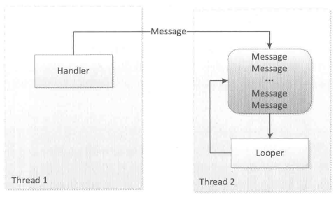
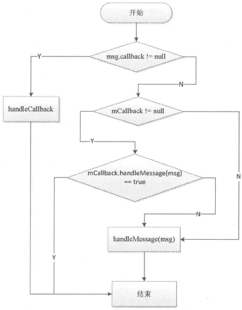

# 第10章 Android的消息机制

本章所要讲述的内容是Android的消息机制。提到消息机制读者应该都不陌生，在日常开发中不可避免地要涉及这方面的内容。从开发的角度来说，Handler是Android消息机制的上层接口，这使得在开发过程中只需要和Handler交互即可。Handler的使用过程很简单，通过它可以轻松地将一个任务切换到Handler所在的线程中去执行。很多人认为Handler的作用是更新UI，这的确没错，但是更新UI仅仅是Handler的一个特殊的使用场景。具体来说是这样的：有时候需要在子线程中进行耗时的I/O操作，可能是读取文件或者访问网络等，当耗时操作完成以后可能需要在UI上做一些改变，由于Android开发规范的限制，我们并不能在子线程中访问UI控件，否则就会触发程序异常，这个时候通过Handler就可以将更新UI的操作切换到主线程中执行。因此，本质上来说，Handler并不是专门用于更新UI的，它只是常被开发者用来更新UI。

Android的消息机制主要是指Handler的运行机制，Handler的运行需要底层的MessageQueue和Looper的支撑。MessageQueue的中文翻译是消息队列，顾名思义，它的内部存储了一组消息，以队列的形式对外提供插入和删除的工作。虽然叫消息队列，但是它的内部存储结构并不是真正的队列，而是采用单链表的数据结构来存储消息列表。Looper的中文翻译为循环，在这里可以理解为消息循环。由于MessageQueue只是一个消息的存储单元，它不能去处理消息，而Looper就填补了这个功能，Looper会以无限循环的形式去查找是否有新消息，如果有的话就处理消息，否则就一直等待着。Looper中还有一个特殊的概念，那就是ThreadLocal，ThreadLocal并不是线程，它的作用是可以在每个线程中存储数据。我们知道，Handler创建的时候会采用当前线程的Looper来构造消息循环系统，那么Handler内部如何获取到当前线程的Looper呢？这就要使用ThreadLocal了，ThreadLocal可以在不同的线程中互不干扰地存储并提供数据，通过ThreadLocal可以轻松获取每个线程的Looper。当然需要注意的是，线程是默认没有Looper的，如果需要使用Handler就必须为线程创建Looper。我们经常提到的主线程，也叫UI线程，它就是ActivityThread，ActivityThread被创建时就会初始化Looper，这也是在主线程中默认可以使用Handler的原因。

## 10.1 Android的消息机制概述

前面提到，Android的消息机制主要是指Handler的运行机制以及Handler所附带的MessageQueue和Looper的工作过程，这三者实际上是一个整体，只不过我们在开发过程中比较多地接触到Handler而已。Handler的主要作用是将一个任务切换到某个指定的线程中去执行，那么Android为什么要提供这个功能呢？或者说Android为什么需要提供在某个具体的线程中执行任务这种功能呢？这是因为Android规定访问UI只能在主线程中进行，如果在子线程中访问UI，那么程序就会抛出异常。ViewRootImpl对UI操作做了验证，这个验证工作是由ViewRootImpl的checkThread方法来完成的，如下所示。

```
 void checkThread() {
     if(mThread != Thread.currentThread()) {
         throw new CalledFromWrongThreadException(
                 "Only the original thread that created a view hierarchy can touch its views.");
     }
 }
```

针对checkThread方法中抛出的异常信息，相信读者在开发中都曾经遇到过。由于这一点的限制，导致必须在主线程中访问UI，但是Android又建议不要在主线程中进行耗时操作，否则会导致程序无法响应即ANR。考虑一种情况，假如我们需要从服务端拉取一些信息并将其显示在UI上，这个时候必须在子线程中进行拉取工作，拉取完毕后又不能在子线程中直接访问UI，如果没有Handler，那么我们的确没有办法将访问UI的工作切换到主线程中去执行。因此，系统之所以提供Handler，主要原因就是为了解决在子线程中无法访问UI的矛盾。

这里再延伸一点，系统为什么不允许在子线程中访问UI呢？这是因为Android的UI控件不是线程安全的，如果在多线程中并发访问可能会导致UI控件处于不可预期的状态，那为什么系统不对UI控件的访问加上锁机制呢？缺点有两个：首先加上锁机制会让UI访问的逻辑变得复杂；其次锁机制会降低UI访问的效率，因为锁机制会阻塞某些线程的执行。鉴于这两个缺点，最简单且高效的方法就是采用单线程模型来处理UI操作，对于开发者来说也不是很麻烦，只是需要通过Handler切换一下UI访问的执行线程即可。

Handler的使用方法这里就不做介绍了，这里描述一下Handler的工作原理。Handler创建时会采用当前线程的Looper来构建内部的消息循环系统，如果当前线程没有Looper，那么就会报错，如下所示。

```
E/AndroidRuntime(27568) : FATAL EXCEPTION: Thread-43484
 E/AndroidRuntime(27568) : java.lang.RuntimeException: Can't create handler
 inside thread that has not called Looper.prepare()
E/AndroidRuntime(27568) : at android.os.Handler.<init> (Handler.java:121)
 E/AndroidRuntime(27568) : at com.ryg.chapter_10.TestActivity$3.run(TestActivity.java:57)
```

如何解决上述问题呢？其实很简单，只需要为当前线程创建Looper即可，或者在一个有Looper的线程中创建Handler也行，具体会在10.2.3节中进行介绍。

Handler创建完毕后，这个时候其内部的Looper以及MessageQueue就可以和Handler一起协同工作了，然后通过Handler的post方法将一个Runnable投递到Handler内部的Looper中去处理，也可以通过Handler的send方法发送一个消息，这个消息同样会在Looper中去处理。其实post方法最终也是通过send方法来完成的，接下来主要来看一下send方法的工作过程。当Handler的send方法被调用时，它会调用MessageQueue的enqueueMessage方法将这个消息放入消息队列中，然后Looper发现有新消息到来时，就会处理这个消息，最终消息中的Runnable或者Handler的handleMessage方法就会被调用。注意Looper是运行在创建Handler所在的线程中的，这样一来Handler中的业务逻辑就被切换到创建Handler所在的线程中去执行了，这个过程可以用图10-1来表示。



图 10-1 Handler的工作过程

## 10.2 Android的消息机制分析

在10.1节中对Android的消息机制已经做了一个概括性的描述，通过图10-1也能够比较好地理解Handler的工作过程。本节将对Android消息机制的实现原理做一个全面的分析。由于Android的消息机制实际上就是Handler的运行机制，因此本节主要围绕着Handler的工作过程来分析Android的消息机制，主要包括Handler、MessageQueue和Looper。同时为了更好地理解Looper的工作原理，本节还会介绍ThreadLocal，通过本节的介绍可以让读者对Android的消息机制有一个深入的理解。

### 10.2.1 ThreadLocal的工作原理

ThreadLocal是一个线程内部的数据存储类，通过它可以在指定的线程中存储数据，数据存储以后，只有在指定线程中可以获取到存储的数据，对于其他线程来说则无法获取到数据。在日常开发中用到ThreadLocal的地方较少，但是在某些特殊的场景下，通过ThreadLocal可以轻松地实现一些看起来很复杂的功能，这一点在Android的源码中也有所体现，比如Looper、ActivityThread以及AMS中都用到了ThreadLocal。具体到ThreadLocal的使用场景，这个不好统一来描述，一般来说，当某些数据是以线程为作用域并且不同线程具有不同的数据副本的时候，就可以考虑采用ThreadLocal。比如对于Handler来说，它需要获取当前线程的Looper，很显然Looper的作用域就是线程并且不同线程具有不同的Looper，这个时候通过ThreadLocal就可以轻松实现Looper在线程中的存取。如果不采用ThreadLocal，那么系统就必须提供一个全局的哈希表供Handler查找指定线程的Looper，这样一来就必须提供一个类似于LooperManager的类了，但是系统并没有这么做而是选择了ThreadLocal，这就是ThreadLocal的好处。

ThreadLocal另一个使用场景是复杂逻辑下的对象传递，比如监听器的传递，有些时候一个线程中的任务过于复杂，这可能表现为函数调用栈比较深以及代码入口的多样性，在这种情况下，我们又需要监听器能够贯穿整个线程的执行过程，这个时候可以怎么做呢？其实这时就可以采用ThreadLocal，采用ThreadLocal可以让监听器作为线程内的全局对象而存在，在线程内部只要通过get方法就可以获取到监听器。如果不采用ThreadLocal，那么我们能想到的可能是如下两种方法：第一种方法是将监听器通过参数的形式在函数调用栈中进行传递，第二种方法就是将监听器作为静态变量供线程访问。上述这两种方法都是有局限性的。第一种方法的问题是当函数调用栈很深的时候，通过函数参数来传递监听器对象这几乎是不可接受的，这会让程序的设计看起来很糟糕。第二种方法是可以接受的，但是这种状态是不具有可扩充性的，比如同时有两个线程在执行，那么就需要提供两个静态的监听器对象，如果有10个线程在并发执行呢？提供10个静态的监听器对象？这显然是不可思议的，而采用ThreadLocal，每个监听器对象都在自己的线程内部存储，根本就不会有方法2的这种问题。

介绍了那么多ThreadLocal的知识，可能还是有点抽象，下面通过实际的例子来演示ThreadLocal的真正含义。首先定义一个ThreadLocal对象，这里选择Boolean类型的，如下所示。

```
 private ThreadLocal<Boolean> mBooleanThreadLocal = new ThreadLocal<Boolean> ();
```

然后分别在主线程、子线程1和子线程2中设置和访问它的值，代码如下所示。

```
mBooleanThreadLocal.set(true);
Log.d(TAG, "[Thread#main]mBooleanThreadLocal=" + mBooleanThreadLocal.get());

new Thread("Thread#1") {
    @Override
    public void run() {
        mBooleanThreadLocal.set(false);
        Log.d(TAG, "[Thread#1]mBooleanThreadLocal=" + mBooleanThreadLocal.get());
    };
}.start();

new Thread("Thread#2") {
    @Override
    public void run() {
        Log.d(TAG, "[Thread#2]mBooleanThreadLocal=" + mBooleanThreadLocal.get());
    };
}.start();
```

在上面的代码中，在主线程中设置mBooleanThreadLocal的值为true，在子线程1中设置mBooleanThreadLocal的值为false，在子线程2中不设置mBooleanThreadLocal的值。然后分别在3个线程中通过get方法获取mBooleanThreadLocal的值，根据前面对ThreadLocal的描述，这个时候，主线程中应该是true，子线程1中应该是false，而子线程2中由于没有设置值，所以应该是null。安装并运行程序，日志如下所示。

```
 D/TestActivity(8676): [Thread#main]mBooleanThreadLocal=true
 D/TestActivity(8676): [Thread#1]mBooleanThreadLocal=false
 D/TestActivity(8676): [Thread#2]mBooleanThreadLocal=null
```

从上面日志可以看出，虽然在不同线程中访问的是同一个ThreadLocal对象，但是它们通过ThreadLocal获取到的值却是不一样的，这就是ThreadLocal的奇妙之处。结合这个例子然后再看一遍前面对ThreadLocal的两个使用场景的理论分析，我们应该就能比较好地理解ThreadLocal的使用方法了。ThreadLocal之所以有这么奇妙的效果，是因为不同线程访问同一个ThreadLocal的get方法，ThreadLocal内部会从各自的线程中取出一个数组，然后再从数组中根据当前ThreadLocal的索引去查找出对应的value值。很显然，不同线程中的数组是不同的，这就是为什么通过ThreadLocal可以在不同的线程中维护一套数据的副本并且彼此互不干扰。

对ThreadLocal的使用方法和工作过程做了介绍后，下面分析ThreadLocal的内部实现，ThreadLocal是一个泛型类，它的定义为public class ThreadLocal`<T>`，只要弄清楚ThreadLocal的get和set方法就可以明白它的工作原理。

首先看ThreadLocal的set方法，如下所示。

```
 public void set(T value) {
     Thread currentThread = Thread.currentThread();
     Values values = values(currentThread);
     if(values == null) {
         values = initializeValues(currentThread) ;
     }
     values.put(this, value);
 }
```

在上面的set方法中，首先会通过values方法来获取当前线程中的ThreadLocal数据，如何获取呢？其实获取的方式也是很简单的，在Thread类的内部有一个成员专门用于存储线程的ThreadLocal的数据：ThreadLocal.Values localValues，因此获取当前线程的ThreadLocal数据就变得异常简单了。如果localValues的值为null，那么就需要对其进行初始化，初始化后再将ThreadLocal的值进行存储。下面看一下ThreadLocal的值到底是如何在localValues中进行存储的。在localValues内部有一个数组：private Object[] table，ThreadLocal的值就存在在这个table数组中。下面看一下localValues是如何使用put方法将ThreadLocal的值存储到table数组中的，如下所示。

```
 void put(ThreadLocal<?> key, Object value) {
     cleanUp() ;

     // Keep track of first tombstone. That's where we want to go back
     // and add an entry if necessary.
     int firstTombstone = -1;

     for(int index = key.hash & mask;; index = next(index)) {
         Object k = table[index];

         if(k == key.reference) {
             // Replace existing entry.
             table[index + 1] = value;
             return;
         }

         if(k == null) {
             if(firstTombstone == -1) {
                 // Fill in null slot.
                 table[index] = key.reference;
                 table[index + 1] = value;
                 size++;
                 return;
             }

             // Go back and replace first tombstone.
             table [firstTombstone] = key.reference;
            table [firstTombstone + 1] = value;
            tombstones--;
             size++;
             return;
         }

        // Remember first tombstone.
        if(firstTombstone == -1 && k == TOMBSTONE) {
            firstTombstone = index;
         }
     }
}
```

上面的代码实现了数据的存储过程，这里不去分析它的具体算法，但是我们可以得出一个存储规则，那就是ThreadLocal的值在table数组中的存储位置总是为ThreadLocal的reference字段所标识的对象的下一个位置，比如ThreadLocal的reference对象在table数组中的索引为index，那么ThreadLocal的值在table数组中的索引就是index+1。最终ThreadLocal的值将会被存储在table数组中：table[index+1]=value。

上面分析了ThreadLocal的set方法，这里分析它的get方法，如下所示。

```
 public T get() {
     // Optimized for the fast path.
     Thread currentThread = Thread.currentThread();
    Values values = values(currentThread) ;
     if(values != null) {
         Object [] table = values.table;
         int index = hash & values.mask;
         if(this.reference == table[index]) {
             return(T) table[index + 1];
         }
     } else {
        values = initializeValues(currentThread) ;
     }

    return(T) values.getAfterMiss(this);
 }
```

可以发现，ThreadLocal的get方法的逻辑也比较清晰，它同样是取出当前线程的localValues对象，如果这个对象为null那么就返回初始值，初始值由ThreadLocal的initialValue方法来描述，默认情况下为null，当然也可以重写这个方法，它的默认实现如下所示。

```
 /**
 * Provides the initial value of this variable for the current thread.
  * The default implementation returns {@code null}.
 *
  * @return the initial value of the variable.
 */
protected T initialValue() {
     return null;
 }
```

如果localValues对象不为null，那就取出它的table数组并找出ThreadLocal的reference对象在table数组中的位置，然后table数组中的下一个位置所存储的数据就是ThreadLocal的值。

从ThreadLocal的set和get方法可以看出，它们所操作的对象都是当前线程的localValues对象的table数组，因此在不同线程中访问同一个ThreadLocal的set和get方法，它们对ThreadLocal所做的读/写操作仅限于各自线程的内部，这就是为什么ThreadLocal可以在多个线程中互不干扰地存储和修改数据，理解ThreadLocal的实现方式有助于理解Looper的工作原理。

### 10.2.2 消息队列的工作原理

消息队列在Android中指的是MessageQueue，MessageQueue主要包含两个操作：插入和读取。读取操作本身会伴随着删除操作，插入和读取对应的方法分别为enqueueMessage和next，其中enqueueMessage的作用是往消息队列中插入一条消息，而next的作用是从消息队列中取出一条消息并将其从消息队列中移除。尽管MessageQueue叫消息队列，但是它的内部实现并不是用的队列，实际上它是通过一个单链表的数据结构来维护消息列表，单链表在插入和删除上比较有优势。下面主要看一下它的enqueueMessage和next方法的实现，enqueueMessage的源码如下所示。

```
boolean enqueueMessage(Message msg, long when) {
     ...

     synchronized(this) {
         ...

        msg.markInUse();
        msg.when = when;
        Message p = mMessages;
        boolean needWake;
         if(p == null || when == 0 || when < p.when) {
             // New head, wake up the event queue if blocked.
             msg.next = p;
             mMessages = msg;
             needWake = mBlocked;
         } else {
             // Inserted within the middle of the queue. Usually we don't have to wake
             // up the event queue unless there is a barrier at the head of the queue
             // and the message is the earliest asynchronous message in the queue.
             needWake = mBlocked && p.target == null && msg.isAsynchronous() ;
             Message prev;
             for (;;) {
                 prev = p;
                 p = p.next;
                 if(p == null || when < p.when) {
                     break;
                 }
                 if(needWake && p.isAsynchronous()) {
                     needWake = false;
                 }
             }
             msg.next = p; // invariant: p == prev.next
             prev.next = msg;
         }

         // We can assume mPtr != 0 because mQuitting is false.
         if(needWake) {
             nativeWake(mPtr) ;
         }
     }
     return true;
 }
```

从enqueueMessage的实现来看，它的主要操作其实就是单链表的插入操作，这里就不再过多解释了，下面看一下next方法的实现，next的主要逻辑如下所示。

```
Message next() {
     ...

     int pendingIdleHandlerCount = -1; // -1 only during first iteration
     int nextPollTimeoutMillis = 0;
     for (;;) {
         if(nextPollTimeoutMillis != 0) {
             Binder. flushPendingCommands() ;
         }

         nativePollOnce(ptr, nextPollTimeoutMillis) ;

         synchronized(this) {
             // Try to retrieve the next message. Return if found.
             final long now = SystemClock.uptimeMillis();
             Message prevMsg = null;
             Message msg = mMessages;
             if(msg != null && msg.target == null) {
                 // Stalled by a barrier. Find the next asynchronous message in the queue.
                 do {
                     prevMsg = msg;
                     msg = msg.next;
                 } while(msg != null && !msg.isAsynchronous());
             }
             if(msg != null) {
                 if(now < msg.when) {
                     // Next message is not ready. Set a timeout to wake up when it is ready.
                     nextPollTimeoutMillis = (int) Math.min(msg.when - now,
                     Integer.MAX_VALUE) ;
                 } else {
                     // Got a message.
                     mBlocked = false;
                     if(prevMsg != null) {
                         prevMsg.next = msg.next;
                     } else {
                         mMessages = msg.next;
                }
                     msg.next = null;
                     if(false) Log.v("MessageQueue", "Returning message: "
                     + msg);
                     return msg;
                 }
             } else {
                 // No more messages.
                nextPollTimeoutMillis = -1;
                }
             ...

         }
         ...
    }
}
```

可以发现next方法是一个无限循环的方法，如果消息队列中没有消息，那么next方法会一直阻塞在这里。当有新消息到来时，next方法会返回这条消息并将其从单链表中移除。

### 10.2.3 Looper的工作原理

在10.2.2节中介绍了消息队列的主要实现，本节将分析Looper的具体实现。Looper在Android的消息机制中扮演着消息循环的角色，具体来说就是它会不停地从MessageQueue中查看是否有新消息，如果有新消息就会立刻处理，否则就一直阻塞在那里。首先看一下它的构造方法，在构造方法中它会创建一个MessageQueue即消息队列，然后将当前线程的对象保存起来，如下所示。

```
private Looper(boolean quitAllowed) {
    mQueue = new MessageQueue(quitAllowed) ;
    mThread = Thread.currentThread() ;
 }
```

我们知道，Handler的工作需要Looper，没有Looper的线程就会报错，那么如何为一个线程创建Looper呢？其实很简单，通过Looper.prepare()即可为当前线程创建一个Looper，接着通过Looper.loop()来开启消息循环，如下所示。

```
 new Thread("Thread#2") {
     @Override
    public void run() {
         Looper .prepare() ;
         Handler handler = new Handler();
         Looper. loop();
     };
 }.start();
```

Looper除了prepare方法外，还提供了prepareMainLooper方法，这个方法主要是给主线程也就是ActivityThread创建Looper使用的，其本质也是通过prepare方法来实现的。由于主线程的Looper比较特殊，所以Looper提供了一个getMainLooper方法，通过它可以在任何地方获取到主线程的Looper。Looper也是可以退出的，Looper提供了quit和quitSafely来退出一个Looper，二者的区别是：quit会直接退出Looper，而quitSafely只是设定一个退出标记，然后把消息队列中的已有消息处理完毕后才安全地退出。Looper退出后，通过Handler发送的消息会失败，这个时候Handler的send方法会返回false。在子线程中，如果手动为其创建了Looper，那么在所有的事情完成以后应该调用quit方法来终止消息循环，否则这个子线程就会一直处于等待的状态，而如果退出Looper以后，这个线程就会立刻终止，因此建议不需要的时候终止Looper。

Looper最重要的一个方法是loop方法，只有调用了loop后，消息循环系统才会真正地起作用，它的实现如下所示。

```
 /**
  * Run the message queue in this thread. Be sure to call
  * {@link #quit()} to end the loop.
  */
 public static void loop() {
     final Looper me = myLooper();
     if(me == null) {
         throw new RuntimeException("No Looper; Looper.prepare() wasn't called on this thread.");
     }
     final MessageQueue queue = me.mQueue;

     // Make sure the identity of this thread is that of the local process,
     // and keep track of what that identity token actually is.
     Binder.clearCallingIdentity() ;
     final long ident = Binder.clearCallingIdentity();
    for (;;) {
        Message msg = queue.next(); // might block
         if(msg == null) {
             // No message indicates that the message queue is quitting.
             return;
         }

         // This must be in a local variable, in case a UI event sets the logger
         Printer logging = me.mLogging;
         if(logging != null) {
             logging .println(">>>>> Dispatching to " + msg.target + " " +
                     msg.callback + ": " + msg.what);
         }

        msg.target.dispatchMessage(msg) ;

        if(logging != null) {
            logging.println("<<<<< Finished to " + msg.target + " " +
            msg.callback) ;
         }

         // Make sure that during the course of dispatching the
         // identity of the thread wasn't corrupted.
         final long newIdent = Binder.clearCallingIdentity();
         if(ident != newIdent) {
             Log.wtf(TAG, "Thread identity changed from 0x"
                     + Long.toHexString(ident) + " to 0x"
                     + Long.toHexString(newIdent)+" while dispatching to "
                     + msg.target.getClass() .getName() + " "
                     + msg.callback + " what=" + msg.what);
         }

         msg.recycleUnchecked() ;
     }
 }
```

Looper的loop方法的工作过程也比较好理解，loop方法是一个死循环，唯一跳出循环的方式是MessageQueue的next方法返回了null。当Looper的quit方法被调用时，Looper就会调用MessageQueue的quit或者quitSafely方法来通知消息队列退出，当消息队列被标记为退出状态时，它的next方法就会返回null。也就是说，Looper必须退出，否则loop方法就会无限循环下去。loop方法会调用MessageQueue的next方法来获取新消息，而next是一个阻塞操作，当没有消息时，next方法会一直阻塞在那里，这也导致loop方法一直阻塞在那里。如果MessageQueue的next方法返回了新消息，Looper 就会处理这条消息：msg.target.dispatchMessage(msg)，这里的msg.target是发送这条消息的Handler对象，这样Handler发送的消息最终又交给它的dispatchMessage方法来处理了。但是这里不同的是，Handler的dispatchMessage方法是在创建Handler时所使用的Looper中执行的，这样就成功地将代码逻辑切换到指定的线程中去执行了。

### 10.2.4 Handler的工作原理

Handler的工作主要包含消息的发送和接收过程。消息的发送可以通过post的一系列方法以及send的一系列方法来实现，post的一系列方法最终是通过send的一系列方法来实现的。发送一条消息的典型过程如下所示。

```
public final boolean sendMessage(Message msg)
 {
     return sendMessageDelayed(msg, 0);
 }

 public final boolean sendMessageDelayed(Message msg, long delayMillis)
 {
     if(delayMillis < 0) {
         delayMillis = 0;
     }
     return sendMessageAtTime(msg, SystemClock.uptimeMillis() + delayMillis);
 }

 public boolean sendMessageAtTime(Message msg, long uptimeMillis) {
     MessageQueue queue = mQueue;
     if(queue == null) {
         RuntimeException e = new RuntimeException(
                 this + " sendMessageAtTime() called with no mQueue");
         Log.w("Looper", e.getMessage(), e);
         return false;
     }
     return enqueueMessage(queue, msg, uptimeMillis);
 }

private boolean enqueueMessage(MessageQueue queue, Message msg, long
uptimeMillis) {
    msg.target = this;
     if(mAsynchronous) {
        msg.setAsynchronous(true) ;
     }
     return queue.enqueueMessage(msg, uptimeMillis);
 }
```

可以发现，Handler发送消息的过程仅仅是向消息队列中插入了一条消息，MessageQueue的next方法就会返回这条消息给Looper，Looper收到消息后就开始处理了，最终消息由Looper交由Handler处理，即Handler的dispatchMessage方法会被调用，这时Handler就进入了处理消息的阶段。dispatchMessage的实现如下所示。

```
 public void dispatchMessage(Message msg) {
     if(msg.callback != null) {
        handleCallback(msg) ;
     } else {
         if(mCallback != null) {
             if(mCallback.handleMessage(msg)) {
                 return;
             }
         }
         handleMessage(msg) ;
     }
 }
```

Handler处理消息的过程如下：

首先，检查Message的callback是否为null，不为null就通过handleCallback来处理消息。Message的callback是一个Runnable对象，实际上就是Handler的post方法所传递的Runnable参数。handleCallback的逻辑也是很简单，如下所示。

```
private static void handleCallback(Message message) {
message.callback.run();
 }
```

其次，检查mCallback是否为null，不为null就调用mCallback的handleMessage方法来处理消息。Callback是个接口，它的定义如下：

```
 /**
  * Callback interface you can use when instantiating a Handler to avoid
  * having to implement your own subclass of Handler.
  *
  * @param msg A {@link android.os.Message Message} object
 * @return True if no further handling is desired
  */
public interface Callback {
    public boolean handleMessage(Message msg) ;
 }
```

通过Callback可以采用如下方式来创建Handler对象：Handler handler = new Handler(callback)。那么Callback的意义是什么呢？源码里面的注释已经做了说明：可以用来创建一个Handler的实例但并不需要派生Handler的子类。在日常开发中，创建Handler最常见的方式就是派生一个Handler的子类并重写其handleMessage方法来处理具体的消息，而Callback给我们提供了另外一种使用Handler的方式，当我们不想派生子类时，就可以通过Callback来实现。

最后，调用Handler的handleMessage方法来处理消息。Handler处理消息的过程可以归纳为一个流程图，如图10-2所示。



图 10-2 Handler消息处理流程图

Handler还有一个特殊的构造方法，那就是通过一个特定的Looper来构造Handler，它的实现如下所示。通过这个构造方法可以实现一些特殊的功能。

```
public Handler(Looper looper) {
     this(looper, null, false);
 }
```

下面看一下Handler的一个默认构造方法public Handler()，这个构造方法会调用下面的构造方法。很明显，如果当前线程没有Looper的话，就会抛出“Can't create handler inside thread that has not called Looper.prepare()”这个异常，这也解释了在没有Looper的子线程中创建Handler会引发程序异常的原因。

```
public Handler(Callback callback, boolean async) {
     ...

    mLooper = Looper.myLooper();
     if(mLooper == null) {
         throw new RuntimeException(
             "Can't create handler inside thread that has not called Looper.prepare()") ;
     }
    mQueue = mLooper.mQueue;
    mCallback = callback;
    mAsynchronous = async;
 }
```

## 10.3 主线程的消息循环

Android的主线程就是ActivityThread，主线程的入口方法为main，在main方法中系统会通过Looper.prepareMainLooper()来创建主线程的Looper以及MessageQueue，并通过Looper.loop()来开启主线程的消息循环，这个过程如下所示。

```
public static void main(String[] args) {
     ...

     Process .setArgV0("<pre-initialized>");

    Looper .prepareMainLooper() ;

    ActivityThread thread = new ActivityThread();
     thread.attach(false);

     if(sMainThreadHandler == null) {
         sMainThreadHandler = thread.getHandler();
     }

    AsyncTask.init();

     if(false) {
         Looper .myLooper() .setMessageLogging(new
                 LogPrinter(Log.DEBUG, "ActivityThread"));
     }

     Looper.loop() ;

     throw new RuntimeException("Main thread loop unexpectedly exited");
 }
```

主线程的消息循环开始了以后，ActivityThread还需要一个Handler来和消息队列进行交互，这个Handler就是ActivityThread.H，它内部定义了一组消息类型，主要包含了四大组件的启动和停止等过程，如下所示。

```
 private class H extends Handler {
     public static final int LAUNCH_ACTIVITY = 100;
     public static final int PAUSE_ACTIVITY = 101;
     public static final int PAUSE_ACTIVITY_FINISHING = 102;
     public static final int STOP_ACTIVITY_SHOW = 103;
     public static final int STOP_ACTIVITY_HIDE = 104;
     public static final int SHOW_WINDOW = 105;
     public static final int HIDE_WINDOW = 106;
     public static final int RESUME_ACTIVITY = 107;
     public static final int SEND_RESULT = 108;
     public static final int DESTROY_ACTIVITY = 109;
     public static final int BIND_APPLICATION = 110;
     public static final int EXIT_APPLICATION = 111;
    public static final int NEW_INTENT = 112;
     public static final int RECEIVER = 113;
     public static final int CREATE_SERVICE = 114;
     public static final int SERVICE_ARGS = 115;
    public static final int STOP_SERVICE = 116;
     ...

 }
```

ActivityThread通过ApplicationThread和AMS进行进程间通信，AMS以进程间通信的方式完成ActivityThread的请求后会回调ApplicationThread中的Binder方法，然后ApplicationThread会向H发送消息，H收到消息后会将ApplicationThread中的逻辑切换到ActivityThread中去执行，即切换到主线程中去执行，这个过程就是主线程的消息循环模型。
