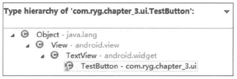
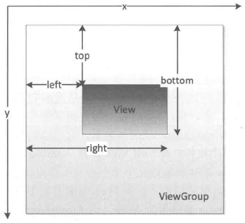
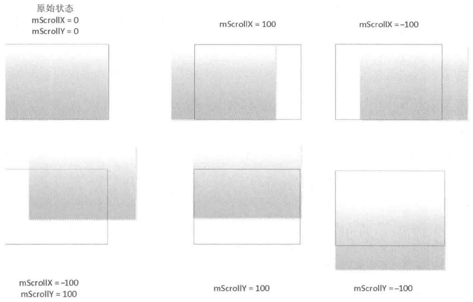

# 第3章 View的事件体系

本章将介绍Android中十分重要的一个概念：View，虽然说View不属于四大组件，但是它的作用堪比四大组件，甚至比Receiver和Provider的重要性都要大。在Android开发中，Activity承担这可视化的功能，同时Android系统提供了很多基础控件，常见的有Button、TextView、CheckBox等。很多时候仅仅使用系统提供的控件是不能满足需求的，因此我们就需要能够根据需求进行新控件的定义，而控件的自定义就需要对Android的View体系有深入的理解，只有这样才能写出完美的自定义控件。同时Android手机属于移动设备，移动设备的一个特点就是用户可以直接通过屏幕来进行一系列操作，一个典型的场景就是屏幕的滑动，用户可以通过滑动来切换到不同的界面。很多情况下我们的应用 都需要支持滑动操作，当处于不同层级的View都可以响应用户的滑动操作时，就会带来一个问题，那就是滑动冲突。如何解决滑动冲突呢？这对于初学者来说的确是个头疼的问题，其实解决滑动冲突本不难，它需要读者对View的事件分发机制有一定的了解，在这个基础上，我们就可以利于这个特性从而得出滑动冲突的解决方法。上述这些内容就是本章所要介绍的内容，同时，View的内部工作原理和自定义View相关的知识会在第4章进行介绍。

## 3.1 View基础知识

本节主要介绍View的一些基础知识，从而为更好地介绍后续的内容做铺垫。主要介绍的内容有：View的位置参数、MotionEvent和TouchSlop对象、VelocityTracker、GestureDetector和Scroller对象，通过对这些基础知识的介绍，可以方便读者理解更复杂的内容。类似的基础概念还有不少，但是本节所介绍的都是一些比较常用的，其他不常用的基础概念读者可以自行了解。

### 3.1.1 什么是View

在介绍View的基础知识之前，我们首先要知道到底什么是View。View是Android中所有控件的基类，不管是简单的Button和TextView还是复杂的RelativeLayout和ListView，它们的共同基类都是View。所以说，View是一种界面层的控件的一种抽象，它代表了一个控件。除了View，还有ViewGroup，从名字来看，它可以被翻译为控件组，言外之意是ViewGroup内部包含了许多个控件，即一组View。在Android的设计中，ViewGroup也继承了View，这就意味着View本身就可以是单个控件也可以是由多个控件组成的一组控件，通过这种关系就形成了View树的结构，这和Web前端中的DOM树的概念是相似的。根据这个概念，我们知道，Button显然是个View，而LinearLayout不但是一个View而且还是一个ViewGroup，而ViewGroup内部是可以有子View的，这个子View同样还可以是ViewGroup，依此类推。

明白View的这种层级关系有助于理解View的工作机制。如图3-1所示，可以看到自定义的TestButton是一个View，它继承了TextView，而TextView则直接继承了View，因此不管怎么说，TestButton都是一个View，同理我们也可以构造出一个继承自ViewGroup的控件。



图 3-1 TestButton的层次结构

### 3.1.2 View的位置参数

View的位置主要由它的四个顶点来决定，分别对应于View的四个属性：top、left、right、bottom，其中top是左上角纵坐标，left是左上角横坐标，right是右下角横坐标，bottom是右下角纵坐标。需要注意的是，这些坐标都是相对于View的父容器来说的，因此它是一种相对坐标，View的坐标和父容器的关系如图3-2所示。在Android中，x轴和y轴的正方向分别为右和下，这点不难理解，不仅仅是Android，大部分显示系统都是按照这个标准来定义坐标系的。



图 3-2 View的位置坐标和父容器的关系

根据图3-2，我们很容易得出View的宽高和坐标的关系：

```
 width = right - left
 height = bottom - top
```

那么如何得到View的这四个参数呢？也很简单，在View的源码中它们对应于mLeft、mRight、mTop和mBottom这四个成员变量，获取方式如下所示。

- Left = getLeft();

- Right = getRight();

- Top = getTop;

- Bottom = getBottom()。

从Android3.0开始，View增加了额外的几个参数：x、y、translationX和translationY，其中x和y是View左上角的坐标，而translationX和translationY是View左上角相对于父容器的偏移量。这几个参数也是相对于父容器的坐标，并且translationX和translationY的默认值是0，和View的四个基本的位置参数一样，View也为它们提供了get/set方法，这几个参数的换算关系如下所示。

x = left + translationX

y = top + translationY

需要注意的是，View在平移的过程中，top和left表示的是原始左上角的位置信息，其值并不会发生改变，此时发生改变的是x、y、translationX和translationY这四个参数。

### 3.1.3 MotionEvent和TouchSlop

1.MotionEvent

在手指接触屏幕后所产生的一系列事件中，典型的事件类型有如下几种：

ACTION_DOWN—手指刚接触屏幕；

ACTION_MOVE 手指在屏幕上移动；

ACTION_UP 手机从屏幕上松开的一瞬间。

正常情况下，一次手指触摸屏幕的行为会触发一系列点击事件，考虑如下几种情况：

- 点击屏幕后离开松开，事件序列为DOWN -> UP；

- 点击屏幕滑动一会再松开，事件序列为DOWN -> MOVE -> ... > MOVE -> UP。

上述三种情况是典型的事件序列，同时通过MotionEvent对象我们可以得到点击事件发生的x和y坐标。为此，系统提供了两组方法：getX/getY和getRawX/getRawY。它们的区别其实很简单，getX/getY返回的是相对于当前View左上角的x和y坐标，而getRawX/getRawY返回的是相对于手机屏幕左上角的x和y坐标。

2.TouchSlop

TouchSlop是系统所能识别出的被认为是滑动的最小距离，换句话说，当手指在屏幕上滑动时，如果两次滑动之间的距离小于这个常量，那么系统就不认为你是在进行滑动操作。原因很简单：滑动的距离太短，系统不认为它是滑动。这是一个常量，和设备有关，在不同设备上这个值可能是不同的，通过如下方式即可获取这个常量：ViewConfiguration.get(getContext()).getScaledTouchSlop()。这个常量有什么意义呢？当我们在处理滑动时，可以利用这个常量来做一些过滤，比如当两次滑动事件的滑动距离小于这个值，我们就可以认为未达到滑动距离的临界值，因此就可以认为它们不是滑动，这样做可以有更好的用户体验。其实如果细心的话，可以在源码中找到这个常量的定义，在frameworks/base/core/res/res/values/config.xml文件中，如下所示。这个“config_viewConfigurationTouchSlop”对应的就是这个常量的定义。

```
<!-- Base "touch slop" value used by ViewConfiguration as a movement threshold
where scrolling should begin. -->
<dimen name="config_viewConfigurationTouchSlop">8dp</dimen>
```

### 3.1.4 VelocityTracker、GestureDetector和Scroller

1.VelocityTracker

速度追踪，用于追踪手指在滑动过程中的速度，包括水平和竖直方向的速度。它的使用过程很简单，首先，在View的onTouchEvent方法中追踪当前单击事件的速度：

```
VelocityTracker velocityTracker = VelocityTracker.obtain();
velocityTracker.addMovement(event);
```

接着，当我们先知道当前的滑动速度时，这个时候可以采用如下方式来获得当前的速度：

```
velocityTracker.computeCurrentVelocity(1000);
int xVelocity = (int) velocityTracker.getXVelocity();
int yVelocity = (int) velocityTracker.getYVelocity();
```

在这一步中有两点需要注意，第一点，获取速度之前必须先计算速度，即getXVelocity和getYVelocity这两个方法的前面必须要调用computeCurrentVelocity方法；第二点，这里的速度是指一段时间内手指所滑过的像素数，比如将时间间隔设为1000ms时，在1s内，手指在水平方向从左向右滑过100像素，那么水平速度就是100。注意速度可以为负数，当手指从右往左滑动时，水平方向速度即为负值，这个需要理解一下。速度的计算可以用如下公式来表示：

速度=（终点位置－起点位置）/时间段

根据上面的公式再加上Android系统的坐标系，可以知道，手指逆着坐标系的正方向滑动，所产生的速度就为负值。另外，computeCurrentVelocity这个方法的参数表示的是一个时间单元或者说时间间隔，它的单位是毫秒（ms），计算速度时得到的速度就是在这个时间间隔内手指在水平或竖直方向上所滑动的像素数。针对上面的例子，如果我们通过velocityTracker.computeCurrentVelocity（100）来获取速度，那么得到的速度就是手指在100ms内所滑过的像素数，因此水平速度就成了10像素/每100ms（这里假设滑动过程是匀速的），即水平速度为10，这点需要好好理解一下。

最后，当不需要使用它的时候，需要调用clear方法来重置并回收内存：

```
velocityTracker.clear();
velocityTracker.recycle();
```

上面就是如何使用VelocityTracker对象的全过程，看起来并不复杂。

2.GestureDetector

手势检测，用于辅助检测用户的单击、滑动、长按、双击等行为。要使用GestureDetector也不复杂，参考如下过程。

首先，需要创建一个GestureDetector对象并实现OnGestureListener接口，根据需要我们还可以实现OnDoubleTapListener从而能够监听双击行为：

```
GestureDetector mGestureDetector = new GestureDetector(this);
//解决长按屏幕后无法拖动的现象
mGestureDetector.setIsLongpressEnabled(false);
```

接着，接管目标View的onTouchEvent方法，在待监听View的onTouchEvent方法中添加如下实现：

```
boolean consume = mGestureDetector.onTouchEvent(event) ;
 return consume;
```

做完了上面两步，我们就可以有选择地实现OnGestureListener和OnDoubleTapListener中的方法了，这两个接口中的方法介绍如表3-1所示。

表 3-1 OnGestureListener和OnDoubleTapListener中的方法介绍

| 方法名 | 描述 | 所属接口 |
| --- | --- | --- |
| onDown | 手指轻轻触摸屏幕的一瞬间，由1个ACTION_DOWN触发 | OnGestureListener |
| onShowPress | 手指轻轻触摸屏幕，尚未松开或拖动，由1个ACTION_DOWN触发<br>＊注意和onDown()的区别，它强调的是没有松开或者拖动的状态 | OnGestureListener |
| onSingleTapUp | 手指（轻轻触摸屏幕后）松开，伴随着1个MotionEvent ACTION_UP而触发，这是单击行为 | OnGestureListener |
| onScroll | 手指按下屏幕并拖动，由1个ACTION_DOWN、多个ACTION_MOVE触发，这是拖动行为 | OnGestureListener |
| onLongPress | 用户长久地按着屏幕不放，即长按 | OnGestureListener |
| onFling | 用户按下触摸屏、快速滑动后松开，由1个ACTION_DOWN、多个ACTION_MOVE和1个ACTION_UP触发，这是快速滑动行为 | OnGestureListener |
| onDoubleTap | 双击，由2次连续的单击组成，它不可能和onSingleTapConfirmed共存 | OnDoubleTapListener |
| onSingleTapConfirmed | 严格的单击行为<br>＊注意它和onSingleTapUp的区别，如果触发了onSingleTapConfirmed，那么后面不可能再紧跟着另一个单击行为，即这只可能是单击，而不可能是双击中的一次单击 | OnDoubleTapListener |
| onDoubleTapEvent | 表示发生了双击行为，在双击的期间，ACTION_DOWN、ACTION_MOVE和ACTION_UP都会触发此回调 | OnDoubleTapListener |

表3-1里面的方法很多，但是并不是所有的方法都会被时常用到，在日常开发中，比较常用的有：onSingleTapUp（单击）、onFling（快速滑动）、onScroll（拖动）、onLongPress（长按）和onDoubleTap（双击）。另外这里要说明的是，实际开发中，可以不使用GestureDetector，完全可以自己在View的onTouchEvent方法中实现所需的监听，这个就看个人的喜好了。这里有一个建议供读者参考：如果只是监听滑动相关的，建议自己在onTouchEvent中实现，如果要监听双击这种行为的话，那么就使用GestureDetector。

3.Scroller

弹性滑动对象，用于实现View的弹性滑动。我们知道，当使用View的scrollTo/scrollBy方法来进行滑动时，其过程是瞬间完成的，这个没有过渡效果的滑动用户体验不好。这个时候就可以使用Scroller来实现有过渡效果的滑动，其过程不是瞬间完成的，而是在一定的时间间隔内完成的。Scroller本身无法让View弹性滑动，它需要和View的computeScroll方法配合使用才能共同完成这个功能。那么如何使用Scroller呢？它的典型代码是固定的，如下所示。至于它为什么能实现弹性滑动，这个在3.2节中会进行详细介绍。

```
Scroller scroller = new Scroller(mContext);

// 缓慢滚动到指定位置
private void smoothScrollTo(int destX, int destY) {
    int scrollX = getScrollX();
    int delta = destX - scrollX;
    // 1000ms内滑向destX，效果就是慢慢滑动
    mScroller.startScroll(scrollX, 0, delta, 0, 1000);
    invalidate();
}

@Override
public void computeScroll() {
    if (mScroller.computeScrollOffset()) {
        scrollTo(mScroller.getCurrX(), mScroller.getCurrY());
        postInvalidate();
    }
}
```

## 3.2 View的滑动

3.1节介绍了View的一些基础知识和概念，本节开始介绍很重要的一个内容：View的滑动。在Android设备上，滑动几乎是应用的标配，不管是下拉刷新还是SlidingMenu，它们的基础都是滑动。从另外一方面来说，Android手机由于屏幕比较小，为了给用户呈现更多的内容，就需要使用滑动来隐藏和显示一些内容。基于上述两点，可以知道，滑动在Android开发中具有很重要的作用，不管一些滑动效果多么绚丽，归根结底，它们都是由不同的滑动外加一些特效所组成的。因此，掌握滑动的方法是实现绚丽的自定义控件的基础。通过三种方式可以实现View的滑动：第一种是通过View本身提供的scrollTo/scrollBy方法来实现滑动；第二种是通过动画给View施加平移效果来实现滑动；第三种是通过改变View的LayoutParams使得View重新布局从而实现滑动。从目前来看，常见的滑动方式就这么三种，下面一一进行分析。

### 3.2.1 使用scrollTo/scrollBy

为了实现View的滑动，View提供了专门的方法来实现这个功能，那就是scrollTo和scrollBy，我们先来看看这两个方法的实现，如下所示。

```
/**
 * Set the scrolled position of your view. This will cause a call to
 * {@link #onScrollChanged(int, int, int, int)} and the view will be
 * invalidated.
 * @param x the x position to scroll to
 * @param y the y position to scroll to
 */
public void scrollTo(int x, int y) {
    if (mScrollX != x || mScrollY != y) {
        int oldX = mScrollX;
        int oldY = mScrollY;
        mScrollX = x;
        mScrollY = y;
        invalidateParentCaches();
        onScrollChanged(mScrollX, mScrollY, oldX, oldY);
        if (!awakenScrollBars()) {
            postInvalidateOnAnimation();
        }
    }
}

/**
 * Move the scrolled position of your view. This will cause a call to
 * {@link #onScrollChanged(int, int, int, int)} and the view will be
 * invalidated.
 * @param x the amount of pixels to scroll by horizontally
 * @param y the amount of pixels to scroll by vertically
 */
public void scrollBy(int x, int y) {
    scrollTo(mScrollX + x, mScrollY + y);
}
```

从上面的源码可以看出，scrollBy实际上也是调用了scrollTo方法，它实现了基于当前位置的相对滑动，而scrollTo则实现了基于所传递参数的绝对滑动，这个不难理解。利用scrollTo和scrollBy来实现View的滑动，这不是一件困难的事，但是我们要明白滑动过程中View内部的两个属性mScrollX和mScrollY的改变规则，这两个属性可以通过getScrollX和getScrollY方法分别得到。这里先简要概况一下：在滑动过程中，mScrollX的值总是等于View左边缘和View内容左边缘在水平方向的距离，而mScrollY的值总是等于View上边缘和View内容上边缘在竖直方向的距离。View边缘是指View的位置，由四个顶点组成，而View内容边缘是指View中的内容的边缘，scrollTo和scrollBy只能改变View内容的位置而不能改变View在布局中的位置。mScrollX和mScrollY的单位为像素，并且当View左边缘在View内容左边缘的右边时，mScrollX为正值，反之为负值；当View上边缘在View内容上边缘的下边时，mScrollY为正值，反之为负值。换句话说，如果从左向右滑动，那么mScrollX为负值，反之为正值；如果从上往下滑动，那么mScrollY为负值，反之为正值。

为了更好地理解这个问题，下面举个例子，如图3-3所示。在图中假设水平和竖直方向的滑动距离都为100像素，针对图中各种滑动情况，都给出了对应的mScrollX和mScrollY的值。根据上面的分析，可以知道，使用scrollTo和scrollBy来实现View的滑动，只能将View的内容进行移动，并不能将View本身进行移动，也就是说，不管怎么滑动，也不可能将当前View滑动到附近View所在的区域，这个需要仔细体会一下。



图 3-3 mScrollX和mScrollY的变换规律示意

### 3.2.2 使用动画

上一节介绍了采用scrollTo/scrollBy来实现View的滑动，本节介绍另外一种滑动方式，即使用动画，通过动画我们能够让一个View进行平移，而平移就是一种滑动。使用动画来移动View，主要是操作View的translationX和translationY属性，既可以采用传统的View动画，也可以采用属性动画，如果采用属性动画的话，为了能够兼容3.0以下的版本，需要采用开源动画库nineoldandroids（http://nineoldandroids.com/）。

采用View动画的代码，如下所示。此动画可以在100ms内将一个View从原始位置向右下角移动100个像素。

```
<?xml version="1.0" encoding="utf-8"?>
<set xmlns:android="http://schemas.android.com/apk/res/android"
    android:fillAfter="true"
    android:zAdjustment="normal" >
    <translate
        android:duration="100"
        android:fromXDelta="0"
        android:fromYDelta="0"
        android:interpolator="@android:anim/linear_interpolator"
        android:toXDelta="100"
        android:toYDelta="100" />
</set>
```

如果采用属性动画的话，就更简单了，以下代码可以将一个View在100ms内从原始位置向右平移100像素。

```
 ObjectAnimator.ofFloat(targetView, "translationX", 0, 100) .setDuration
 (100) .start();
```

上面简单介绍了通过动画来移动View的方法，关于动画会在第5章中进行详细说明。使用动画来做View的滑动需要注意一点，View动画是对View的影像做操作，它并不能真正改变View的位置参数，包括宽/高，并且如果希望动画后的状态得以保留还必须将fillAfter属性设置为true，否则动画完成后其动画结果会消失。比如我们要把View向右移动100像素，如果fillAfter为false，那么在动画完成的一刹那，View会瞬间恢复到动画前的状态；如果fillAfter为true，在动画完成后，View会停留在距原始位置100像素的右边。使用属性动画并不会存在上述问题，但是在Android3.0以下无法使用属性动画，这个时候我们可以使用动画兼容库nineoldandroids来实现属性动画，尽管如此，在Android3.0以下的手机上通过nineoldandroids来实现的属性动画本质上仍然是View动画。

上面提到View动画并不能真正改变View的位置，这会带来一个很严重的问题。试想一下，比如我们通过View动画将一个Button向右移动100px，并且这个View设置的有单击事件，然后你会惊奇地发现，单击新位置无法触发onClick事件，而单击原始位置仍然可以触发onClick事件，尽管Button已经不在原始位置了。这个问题带来的影响是致命的，但是它却又是可以理解的，因为不管Button怎么做变换，但是它的位置信息（四个顶点和宽/高）并不会随着动画而改变，因此在系统眼里，这个Button并没有发生任何改变，它的真身仍然在原始位置。在这种情况下，单击新位置当然不会触发onClick事件了，因为Button的真身并没有发生改变，在新位置上只是View的影像而已。基于这一点，我们不能简单地给一个View做平移动画并且还希望它在新位置继续触发一些单击事件。

从Android3.0开始，使用属性动画可以解决上面的问题，但是大多数应用都需要兼容到Android2.2，在Android2.2上无法使用属性动画，因此这里还是会有问题。那么这种问题难道就无法解决了吗？也不是的，虽然不能直接解决这个问题，但是还可以间接解决这个问题，这里给出一个简单的解决方法。针对上面View动画的问题，我们可以在新位置预先创建一个和目标Button一模一样的Button，它们不但外观一样连onClick事件也一样。当目标Button完成平移动画后，就把目标Button隐藏，同时把预先创建的Button显示出来，通过这种间接的方式我们解决了上面的问题。这仅仅是个参考，面对这种问题时读者可以灵活应对。

### 3.2.3 改变布局参数

本节将介绍第三种实现View滑动的方法，那就是改变布局参数，即改变LayoutParams。这个比较好理解了，比如我们想把一个Button向右平移100px，我们只需要将这个Button的LayoutParams里的marginLeft参数的值增加100px即可，是不是很简单呢？还有一种情形，为了达到移动Button的目的，我们可以在Button的左边放置一个空的View，这个空View的默认宽度为0，当我们需要向右移动Button时，只需要重新设置空View的宽度即可，当空View的宽度增大时（假设Button的父容器是水平方向的LinearLayout），Button就自动被挤向右边，即实现了向右平移的效果。如何重新设置一个View的LayoutParams呢？很简单，如下所示。

```
MarginLayoutParams params = (MarginLayoutParams)mButton1.getLayoutParams();
params.width += 100;
params.leftMargin += 100;
mButton1.requestLayout();
//或者mButton1.setLayoutParams(params);
```

通过改变LayoutParams的方式去实现View的滑动同样是一种很灵活的方法，需要根据不同情况去做不同的处理。

### 3.2.4 各种滑动方式的对比

上面分别介绍了三种不同的滑动方式，它们都能实现View的滑动，那么它们之间的差别是什么呢？

先看scrollTo/scrollBy这种方式，它是View提供的原生方法，其作用是专门用于View的滑动，它可以比较方便地实现滑动效果并且不影响内部元素的单击事件。但是它的缺点也是很显然的：它只能滑动View的内容，并不能滑动View本身。

再看动画，通过动画来实现View的滑动，这要分情况。如果是Android3.0以上并采用属性动画，那么采用这种方式没有明显的缺点；如果是使用View动画或者在Android3.0以下使用属性动画，均不能改变View本身的属性。在实际使用中，如果动画元素不需要响应用户的交互，那么使用动画来做滑动是比较合适的，否则就不太适合。但是动画有一个很明显的优点，那就是一些复杂的效果必须要通过动画才能实现。

最后再看一下改变布局这种方式，它除了使用起来麻烦点以外，也没有明显的缺点，它的主要适用对象是一些具有交互性的View，因为这些View需要和用户交互，直接通过动画去实现会有问题，这在3.2.2节中已经有所介绍，所以这个时候我们可以使用直接改变布局参数的方式去实现。

针对上面的分析做一下总结，如下所示。

- scrollTo/scrollBy：操作简单，适合对View内容的滑动；

- 动画：操作简单，主要适用于没有交互的View和实现复杂的动画效果；

- 改变布局参数：操作稍微复杂，适用于有交互的View。

下面我们实现一个跟手滑动的效果，这是一个自定义View，拖动它可以让它在整个屏幕上随意滑动。这个View实现起来很简单，我们只要重写它的onTouchEvent方法并处理ACTION_MOVE事件，根据两次滑动之间的距离就可以实现它的滑动了。为了实现全屏滑动，我们采用动画的方式来实现。原因很简单，这个效果无法采用scrollTo来实现。另外，它还可以采用改变布局的方式来实现，这里仅仅是为了演示，所以就选择了动画的方式，核心代码如下所示。

```
public boolean onTouchEvent(MotionEvent event) {
    int x = (int) event.getRawX();
    int y = (int) event.getRawY();
    switch (event.getAction()) {
    case MotionEvent.ACTION_DOWN: {
        break;
    }
    case MotionEvent.ACTION_MOVE: {
        int deltaX = x - mLastX;
        int deltaY = y - mLastY;
        Log.d(TAG, "move, deltaX:" + deltaX + " deltaY:" + deltaY);
        int translationX = (int)ViewHelper.getTranslationX(this) + deltaX;
        int translationY = (int)ViewHelper.getTranslationY(this) + deltaY;
        ViewHelper.setTranslationX(this, translationX);
        ViewHelper.setTranslationY(this, translationY);
        break;
    }
    case MotionEvent.ACTION_UP: {
        break;
    }
    default:
        break;
    }

    mLastX = x;
    mLastY = y;
    return true;
}
```

通过上述代码可以看出，这一全屏滑动的效果实现起来相当简单。首先我们通过getRawX和getRawY方法来获取手指当前的坐标，注意不能使用getX和getY方法，因为这个是要全屏滑动的，所以需要获取当前点击事件在屏幕中的坐标而不是相对于View本身的坐标；其次，我们要得到两次滑动之间的位移，有了这个位移就可以移动当前的View，移动方法采用的是动画兼容库nineoldandroids中的ViewHelper类所提供的setTranslationX和setTranslationY方法。实际上，ViewHelper类提供了一系列get/set方法，因为View的setTranslationX和setTranslationY只能在Android3.0及其以上版本才能使用，但是ViewHelper所提供的方法是没有版本要求的，与此类似的还有setX、setScaleX、setAlpha等方法，这一系列方法实际上是为属性动画服务的，更详细的内容会在第5章进行进一步的介绍。这个自定义View可以在2.x及其以上版本工作，但是由于动画的性质，如果给它加上onClick事件，那么在3.0以下版本它将无法在新位置响应用户的点击，这个问题在前面已经提到过。

## 3.3 弹性滑动

知道了View的滑动，我们还要知道如何实现View的弹性滑动，比较生硬地滑动过去，这种方式的用户体验实在太差了，因此我们要实现渐近式滑动。那么如何实现弹性滑动呢？其实实现方法有很多，但是它们都有一个共同思想：将一次大的滑动分成若干次小的滑动并在一个时间段内完成，弹性滑动的具体实现方式有很多，比如通过Scroller、Handler#postDelayed以及Thread#sleep等，下面一一进行介绍。

### 3.3.1 使用Scroller

Scroller的使用方法在3.1.4节中已经进行了介绍，下面我们来分析一下它的源码，从而探究为什么它能实现View的弹性滑动。

```
Scroller scroller = new Scroller(mContext);
// 缓慢滚动到指定位置
private void smoothScrollTo(int destX, int destY) {
    int scrollX = getScrollX();
    int deltaX = destX - scrollX;
    // 1000ms内滑向destX，效果就是慢慢滑动
    mScroller.startScroll(scrollX, 0, deltaX, 0, 1000);
    invalidate();
}

@Override
public void computeScroll() {
    if (mScroller.computeScrollOffset()) {
        scrollTo(mScroller.getCurrX(), mScroller.getCurrY());
        postInvalidate();
    }
}
```

上面是Scroller的典型的使用方法，这里先描述它的工作原理：当我们构造一个Scroller对象并且调用它的startScroll方法时，Scroller内部其实什么也没做，它只是保存了我们传递的几个参数，这几个参数从startScroll的原型上就可以看出来，如下所示。

```
public void startScroll(int startX, int startY, int dx, int dy, int duration) {
    mMode = SCROLL_MODE;
    mFinished = false;
    mDuration = duration;
    mStartTime = AnimationUtils.currentAnimationTimeMillis();
    mStartX = startX;
    mStartY = startY;
    mFinalX = startX + dx;
    mFinalY = startY + dy;
    mDeltaX = dx;
    mDeltaY = dy;
    mDurationReciprocal = 1.0f / (float) mDuration;
}
```

这个方法的参数含义很清楚，startX和startY表示的是滑动的起点，dx和dy表示的是要滑动的距离，而duration表示的是滑动时间，即整个滑动过程完成所需要的时间，注意这里的滑动是指View内容的滑动而非View本身位置的改变。可以看到，仅仅调用startScroll方法是无法让View滑动的，因为它内部并没有做滑动相关的事，那么Scroller到底是如何让View弹性滑动的呢？答案就是startScroll方法下面的invalidate方法，虽然有点不可思议，但是的确是这样的。invalidate方法会导致View重绘，在View的draw方法中又会去调用computeScroll方法，computeScroll方法在View中是一个空实现，因此需要我们自己去实现，上面的代码已经实现了computeScroll方法。正是因为这个computeScroll方法，View才能实现弹性滑动。这看起来还是很抽象，其实这样的：当View重绘后会在draw方法中调用computeScroll，而computeScroll又会去向Scroller获取当前的scrollX和scrollY；然后通过scrollTo方法实现滑动；接着又调用postInvalidate方法来进行第二次重绘，这一次重绘的过程和第一次重绘一样，还是会导致computeScroll方法被调用；然后继续向Scroller获取当前的scrollX和scrollY，并通过scrollTo方法滑动到新的位置，如此反复，直到整个滑动过程结束。

我们再看一下Scroller的computeScrollOffset方法的实现，如下所示。

```
/**
 * Call this when you want to know the new location. If it returns true,
 * the animation is not yet finished.
 */
public boolean computeScrollOffset() {
    ...
    int timePassed = (int)(AnimationUtils.currentAnimationTimeMillis() -
    mStartTime);
    if (timePassed < mDuration) {
        switch (mMode) {
        case SCROLL_MODE:
            final float x = mInterpolator.getInterpolation(timePassed *
            mDurationReciprocal);
            mCurrX = mStartX + Math.round(x * mDeltaX);
            mCurrY = mStartY + Math.round(x * mDeltaY);
            break;
        ...
        }
    }
    return true;
}
```

是不是突然就明白了？这个方法会根据时间的流逝来计算出当前的scrollX和scrollY的值。计算方法也很简单，大意就是根据时间流逝的百分比来算出scrollX和scrollY改变的百分比并计算出当前的值，这个过程类似于动画中的插值器的概念，这里我们先不去深究这个具体过程。这个方法的返回值也很重要，它返回true表示滑动还未结束，false则表示滑动已经结束，因此当这个方法返回true时，我们要继续进行View的滑动。

通过上面的分析，我们应该明白Scroller的工作原理了，这里做一下概括：Scroller本身并不能实现View的滑动，它需要配合View的computeScroll方法才能完成弹性滑动的效果，它不断地让View重绘，而每一次重绘距滑动起始时间会有一个时间间隔，通过这个时间间隔Scroller就可以得出View当前的滑动位置，知道了滑动位置就可以通过scrollTo方法来完成View的滑动。就这样，View的每一次重绘都会导致View进行小幅度的滑动，而多次的小幅度滑动就组成了弹性滑动，这就是Scroller的工作机制。由此可见，Scroller的设计思想是多么值得称赞，整个过程中它对View没有丝毫的引用，甚至在它内部连计时器都没有。

### 3.3.2 通过动画

动画本身就是一种渐近的过程，因此通过它来实现的滑动天然就具有弹性效果，比如以下代码可以让一个View的内容在100ms内向左移动100像素。

```
 ObjectAnimator.ofFloat(targetView, "translationX", 0, 100) .setDuration
 (100) .start();
```

不过这里想说的并不是这个问题，我们可以利用动画的特性来实现一些动画不能实现的效果。还拿scrollTo来说，我们也想模仿Scroller来实现View的弹性滑动，那么利用动画的特性，我们可以采用如下方式来实现：

```
 final int startX = 0;
 final int deltaX = 100;
ValueAnimator animator = ValueAnimator.ofInt(0, 1).setDuration(1000);
animator.addUpdateListener(new AnimatorUpdateListener() {
    @Override
    public void onAnimationUpdate(ValueAnimator animator) {
        float fraction = animator.getAnimatedFraction();
        mButton1.scrollTo(startX + (int)(deltaX * fraction), 0);
    }
});
animator.start();
```

在上述代码中，我们的动画本质上没有作用于任何对象上，它只是在1000ms内完成了整个动画过程。利用这个特性，我们就可以在动画的每一帧到来时获取动画完成的比例，然后再根据这个比例计算出当前View所要滑动的距离。注意，这里的滑动针对的是View的内容而非View本身。可以发现，这个方法的思想其实和Scroller比较类似，都是通过改变一个百分比配合scrollTo方法来完成View的滑动。需要说明一点，采用这种方法除了能够完成弹性滑动以外，还可以实现其他动画效果，我们完全可以在onAnimationUpdate方法中加上我们想要的其他操作。

### 3.3.3 使用延时策略

本节介绍另外一种实现弹性滑动的方法，那就是延时策略。它的核心思想是通过发送一系列延时消息从而达到一种渐近式的效果，具体来说可以使用Handler或View的postDelayed方法，也可以使用线程的sleep方法。对于postDelayed方法来说，我们可以通过它来延时发送一个消息，然后在消息中来进行View的滑动，如果接连不断地发送这种延时消息，那么就可以实现弹性滑动的效果。对于sleep方法来说，通过在while循环中不断地滑动View和sleep，就可以实现弹性滑动的效果。

下面采用Handler来做个示例，其他方法请读者自行去尝试，思想都是类似的。下面的代码在大约1000ms内将View的内容向左移动了100像素，代码比较简单，就不再详细介绍了。之所以说大约1000ms，是因为采用这种方式无法精确地定时，原因是系统的消息调度也是需要时间的，并且所需时间不定。

```
private static final int MESSAGE_SCROLL_TO = 1;
private static final int FRAME_COUNT = 30;
private static final int DELAYED_TIME = 33;

private int mCount = 0;

@SuppressLint("HandlerLeak")
private Handler mHandler = new Handler() {
    public void handleMessage(Message msg) {
        switch (msg.what) {
        case MESSAGE_SCROLL_TO: {
            mCount++;
            if (mCount <= FRAME_COUNT) {
                float fraction = mCount / (float) FRAME_COUNT;
                int scrollX = (int) (fraction * 100);
                mButton1.scrollTo(scrollX, 0);
                mHandler.sendEmptyMessageDelayed(MESSAGE_SCROLL_TO,
                DELAYED_TIME);
            }
            break;
        }

        default:
            break;
        }
    };
};
```

上面几种弹性滑动的实现方法，在介绍中侧重更多的是实现思想，在实际使用中可以对其灵活地进行扩展从而实现更多复杂的效果。
