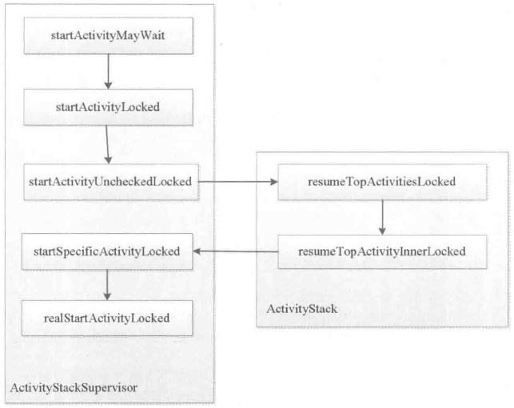
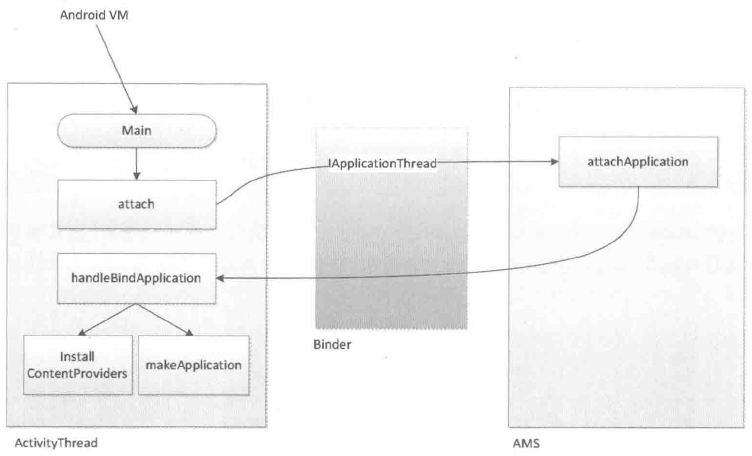

# 第9章 四大组件的工作过程

本章讲述Android中的四大组件的工作过程。说到四大组件，开发者都再熟悉不过了，它们是Activity、Service、BroadcastReceiver和ContentProvider。如何使用四大组件，这不是本章关心的，毕竟这是开发者都熟悉的内容，本章按照如下的逻辑来分析Android的四大组件：首先会对四大组件的运行状态和工作方式做一个概括化的描述，接着对四大组件的工作过程进行分析，通过本章的分析读者可以对四大组件有一个更深刻的认识。

本章主要侧重于四大组件工作过程的分析，通过分析它们的工作过程我们可以更好地理解系统内部的运行机制。本章的意义在于加深读者对四大组件的工作方式的认识，由于四大组件的特殊性，我们有必要对它们的工作过程有一定的了解，这也有助于加深对Android整体的体系结构的认识。很多情况下，只有对Android体系结构有一定认识，在实际的开发中才能写出优秀的代码。

## 9.1 四大组件的运行状态

Android的四大组件中除了BroadcastReceiver以外，其他三种组件都必须在AndroidManifest中注册，对于BroadcastReceiver来说，它既可以在AndroidManifest中注册也可以通过代码来注册。在调用方式上，Activity、Service和BroadcastReceiver需要借助Intent，而ContentProvider则无须借助Intent。

Activity是一种展示型组件，用于向用户直接地展示一个界面，并且可以接收用户的输入信息从而进行交互。Activity是最重要的一种组件，对用户来说，Activity就是一个Android应用的全部，这是因为其他三大组件对用户来说都是不可感知的。Activity的启动由Intent触发，其中Intent可以分为显式Intent和隐式Intent，显式Intent可以明确地指向一个Activity组件，隐式Intent则指向一个或多个目标Activity组件，当然也可能没有任何一个Activity组件可以处理这个隐式Intent。一个Activity组件可以具有特定的启动模式。关于Activity的启动模式在第1章中已经做了介绍，同一个Activity组件在不同的启动模式下会有不同的效果。Activity组件是可以停止的，在实际开发中可以通过Activity的finish方法来结束一个Activity组件的运行。由此来看，Activity组件的主要作用是展示一个界面并和用户交互，它扮演的是一种前台界面的角色。

Service是一种计算型组件，用于在后台执行一系列计算任务。由于Service组件工作在后台，因此用户无法直接感知到它的存在。Service组件和Activity组件略有不同，Activity组件只有一种运行模式，即Activity处于启动状态，但是Service组件却有两种状态：启动状态和绑定状态。当Service组件处于启动状态时，这个时候Service内部可以做一些后台计算，并且不需要和外界有直接的交互。尽管Service组件是用于执行后台计算的，但是它本身是运行在主线程中的，因此耗时的后台计算仍然需要在单独的线程中去完成。当Service组件处于绑定状态时，这个时候Service内部同样可以进行后台计算，但是处于这种状态时外界可以很方便地和Service组件进行通信。Service组件也是可以停止的，停止一个Service组件稍显复杂，需要灵活采用stopService和unBindService这两个方法才能完全停止一个Service组件。

BroadcastReceiver是一种消息型组件，用于在不同的组件乃至不同的应用之间传递消息。BroadcastReceiver同样无法被用户直接感知，因为它工作在系统内部。BroadcastReceiver也叫广播，广播的注册有两种方式：静态注册和动态注册。静态注册是指在AndroidManifest中注册广播，这种广播在应用安装时会被系统解析，此种形式的广播不需要应用启动就可以收到相应的广播。动态注册广播需要通过Context.registerReceiver()来实现，并且在不需要的时候要通过Context.unRegisterReceiver()来解除广播，此种形态的广播必须要应用启动才能注册并接收广播，因为应用不启动就无法注册广播，无法注册广播就无法收到相应的广播。在实际开发中通过Context的一系列send方法来发送广播，被发送的广播会被系统发送给感兴趣的广播接收者，发送和接收过程的匹配是通过广播接收者的`<intent-filter>`来描述的。可以发现，BroadcastReceiver组件可以用来实现低耦合的观察者模式，观察者和被观察者之间可以没有任何耦合。由于BroadcastReceiver的特性，它不适合用来执行耗时操作。BroadcastReceiver组件一般来说不需要停止，它也没有停止的概念。

ContentProvider是一种数据共享型组件，用于向其他组件乃至其他应用共享数据。和BroadcastReceiver一样，ContentProvider同样无法被用户直接感知。对于一个ContentProvider组件来说，它的内部需要实现增删改查这四种操作，在它的内部维持着一份数据集合，这个数据集合既可以通过数据库来实现，也可以采用其他任何类型来实现，比如List和Map，ContentProvider对数据集合的具体实现并没有任何要求。需要注意的是，ContentProvider内部的insert、delete、update和query方法需要处理好线程同步，因为这几个方法是在Binder线程池中被调用的，另外ContentProvider组件也不需要手动停止。

## 9.2 Activity的工作过程

本节讲述的内容是Activity的工作过程。为了方便日常的开发工作，系统对四大组件的工作过程进行了很大程度的封装，这使得开发者无须关注实现细节即可快速地使用四大组件。Activity作为很重要的一个组件，其内部工作过程系统当然也是做了很多的封装，这种封装使得启动一个Activity变得异常简单。在显式调用的情形下，只需要通过如下代码即可完成：

```
 Intent intent = new Intent(this, TestActivity.class);
 startActivity(intent);
```

通过上面的代码即可启动一个具体的Activity，然后新Activity就会被系统启动并展示在用户的眼前。这个过程对于Android开发者来说最普通不过了，这也是很理所应当的事，但是有没有想过系统内部到底是如何启动一个Activity的呢？比如新Activity的对象是在何时创建的？Activity的onCreate方法又是在何时被系统回调的呢？读者可能会有疑问：在日常开发中并不需要了解Activity底层到底是怎么工作的，那么了解它们又有什么意义呢？没错，在日常开发中是不需要了解系统的底层工作原理，但是如果想要在技术上有进一步的提高，那么就必须了解一些系统的工作原理，这是一个开发人员日后成长为高级工程师乃至架构师所必须具备的技术能力。从另外一个角度来说，Android作为一个优秀的基于Linux的移动操作系统，其内部一定有很多值得我们学习和借鉴的地方，因此了解系统的工作过程就是学习Android操作系统。通过对Android操作系统的学习可以提高我们对操作系统在技术实现上的理解，这对于加强开发人员的内功是很有帮助的。但是有一点，由于Android的内部实现多数都比较复杂，在研究内部实现上应该更加侧重于对整体流程的把握，而不能深入代码细节不能自拔，太深入代码细节往往会导致“只见树木不见森林”的状态。处于这种状态下，无法对整体流程建立足够的认识，取而代之的是烦琐的代码细节，但是代码细节本身并不具有太多的指导意义，因此这种学习状态是要极力避免的。鉴于这一点，本章对Activity以及其他三个组件的工作过程的分析将会侧重于整体流程的讲解，目的是为了让读者对四大组件的工作过程有一个感性的认识并能够给予上层开发一些指导意义。但凡事不是绝对的，如果开发者从事的工作是AndroidRom开发，那底层代码细节还是要有所涉猎的。

本节主要分析Activity的启动过程，通过本节读者可以对Activity的启动过程有一个感性的认识，至于启动模式以及任务栈等概念本节中并未涉及，读者感兴趣的话可以查看相应的代码细节即可。

我们从Activity的startActivity方法开始分析，startActivity方法有好几种重载方式，但它们最终都会调用startActivityForResult方法，它的实现如下所示。

```
public void startActivityForResult(Intent intent, int requestCode,
 @Nullable Bundle options) {
     if(mParent == null) {
         Instrumentation.ActivityResult ar =
             mInstrumentation.execStartActivity(
                 this, mMainThread.getApplicationThread(), mToken, this,
                 intent, requestCode, options);
         if(ar != null) {
             mMainThread.sendActivityResult(
                 mToken, mEmbeddedID, requestCode, ar.getResultCode(),
                 ar.getResultData()) ;
         }
         if(requestCode >= 0) {
             // If this start is requesting a result, we can avoid making
             // the activity visible until the result is received. Setting
             // this code during onCreate(Bundle savedInstanceState) or onResume() will keep the
             // activity hidden during this time, to avoid flickering.
             // This can only be done when a result is requested because
             // that guarantees we will get information back when the
             // activity is finished, no matter what happens to it.
             mStartedActivity = true;
         }

         final View decor = mWindow != null ? mWindow.peekDecorView() : null;
         if(decor != null) {
             decor.cancelPendingInputEvents() ;
         }
         // TODO Consider clearing/flushing other event sources and events for child windows.
     } else {
         if(options != null) {
             mParent.startActivityFromChild(this, intent, requestCode, options) ;
         } else {
             // Note we want to go through this method for compatibility with
             // existing applications that may have overridden it.
             mParent.startActivityFromChild(this, intent, requestCode) ;
         }
     }
     if(options != null && !isTopOfTask()) {
         mActivityTransitionState.startExitOutTransition(this, options);
     }
 }
```

在上面的代码中，我们只需要关注mParent==null这部分逻辑即可。mParent代表的是ActivityGroup，ActivityGroup最开始被用来在一个界面中嵌入多个子Activity，但是其在API13中已经被废弃了，系统推荐采用Fragment来代替ActivityGroup，Fragment的好处就不用多说了。在上面的代码中需要注意mMainThread.getApplicationThread()这个参数，它的类型是ApplicationThread，ApplicationThread是ActivityThread的一个内部类，通过后面的分析可以发现，ApplicationThread和ActivityThread在Activity的启动过程中发挥着很重要的作用。接着看一下Instrumentation的execStartActivity方法，如下所示。

```
 public ActivityResult execStartActivity(
         Context who, IBinder contextThread, IBinder token, Activity target,
         Intent intent, int requestCode, Bundle options) {
     IApplicationThread whoThread = (IApplicationThread) contextThread;
     if(mActivityMonitors != null) {
         synchronized(mSync) {
             final int N = mActivityMonitors.size();
             for (int i=0; i<N; i++) {
                 final ActivityMonitor am = mActivityMonitors.get(i);
                 if(am.match(who, null, intent)) {
                     am.mHits++;
                     if(am.isBlocking()) {
                         return requestCode >= 0 ? am.getResult() : null;
                     }
                    break;
                 }
             }
         }
     }
     try {
         intent.migrateExtraStreamToClipData() ;
         intent.prepareToLeaveProcess() ;
         int result = ActivityManagerNative.getDefault()
             .startActivity(whoThread, who.getBasePackageName(), intent,
                     intent.resolveTypeIfNeeded(who.getContentResolver()),
                     token, target != null ? target.mEmbeddedID : null,
                     requestCode, 0, null, options);
         checkStartActivityResult(result, intent);
     } catch(RemoteException e) {
     }
     return null;
 }
```

从上面的代码可以看出，启动Activity真正的实现由ActivityManagerNative.getDefault()的startActivity方法来完成。ActivityManagerService（下面简称为AMS）继承自ActivityManagerNative，而ActivityManagerNative继承自Binder并实现了IActivityManager这个Binder接口，因此AMS也是一个Binder，它是IActivityManager的具体实现。由于ActivityManagerNative.getDefault()其实是一个IActivityManager类型的Binder对象，因此它的具体实现是AMS。可以发现，在ActivityManagerNative中，AMS这个Binder对象采用单例模式对外提供，Singleton是一个单例的封装类，第一次调用它的get方法时它会通过create方法来初始化AMS这个Binder对象，在后续的调用中则直接返回之前创建的对象，这个过程的源码如下所示。

```
static public IActivityManager getDefault() {
     return gDefault.get();
 }

private static final Singleton<IActivityManager> gDefault = new Singleton
 <IActivityManager>() {
     protected IActivityManager create() {
         IBinder b = ServiceManager.getService("activity");
         if(false) {
             Log.v("ActivityManager", "default service binder = " + b);
         }
         IActivityManager am = asInterface(b);
         if(false) {
             Log.v("ActivityManager", "default service = " + am);
         }
         return am;
     }
 };
```

从上面的分析可以知道，Activity由ActivityManagerNative.getDefault()来启动，而ActivityManagerNative.getDefault()实际上是AMS，因此Activity的启动过程又转移到了AMS中，为了继续分析这个过程，只需要查看AMS的startActivity方法即可。在分析AMS的的startActivity方法之前，我们先回过头来看一下Instrumentation的execStartActivity方法，其中有一行代码：checkStartActivityResult(result，intent)，直观上看起来这个方法的作用像是在检查启动Activity的结果，它的具体实现如下所示。

```
 /** @hide */
 public static void checkStartActivityResult(int res, Object intent) {
     if(res >= ActivityManager.START_SUCCESS) {
         return;
     }

     switch(res) {
         case ActivityManager.START_INTENT_NOT_RESOLVED:
         case ActivityManager.START_CLASS_NOT_FOUND:
             if(intent instanceof Intent && ( (Intent) intent) .getComponent() !=
             null)
                 throw new ActivityNotFoundException(
                         "Unable to find explicit activity class "
                         + ((Intent) intent) .getComponent() .toShortString()
                         + "; have you declared this activity in your AndroidManifest.xml?") ;
             throw new ActivityNotFoundException(
                     "No Activity found to handle " + intent);
         case ActivityManager.START_PERMISSION_DENIED:
             throw new SecurityException("Not allowed to start activity "
                     + intent);
         case ActivityManager.START_FORWARD_AND_REQUEST_CONFLICT:
             throw new AndroidRuntimeException(
                     "FORWARD_RESULT_FLAG used while also requesting a result");
         case ActivityManager.START_NOT_ACTIVITY:
             throw new IllegalArgumentException(
                     "PendingIntent is not an activity");
         case ActivityManager.START_NOT_VOICE_COMPATIBLE:
             throw new SecurityException(
                     "Starting under voice control not allowed for: " +
                     intent);
         default:
             throw new AndroidRuntimeException("Unknown error code "
                     + res + " when starting " + intent);
     }
 }
```

从上面的代码可以看出，checkStartActivityResult的作用很明显，就是检查启动Activity的结果。当无法正确地启动一个Activity时，这个方法会抛出异常信息，其中最熟悉不过的就是“Unable to find explicit activity class; have you declared this activity in your AndroidManifest.xml?”这个异常了，当待启动的Activity没有在AndroidManifest中注册时，就会抛出这个异常。

接着我们继续分析AMS的startActivity方法，如下所示。

```
public final int startActivity(IApplicationThread caller, String callingPackage,
         Intent intent, String resolvedType, IBinder resultTo, String
         resultWho, int requestCode,
         int startFlags, ProfilerInfo profilerInfo, Bundle options) {
     return startActivityAsUser(caller, callingPackage, intent, resolvedType, resultTo,
         resultWho, requestCode, startFlags, profilerInfo, options,
         UserHandle.getCallingUserId());
 }

public final int startActivityAsUser(IApplicationThread caller, String
callingPackage,
         Intent intent, String resolvedType, IBinder resultTo, String
         resultWho, int requestCode,
         int startFlags, ProfilerInfo profilerInfo,Bundle options, int userId) {
     enforceNotIsolatedCaller("startActivity");
     userId = handleIncomingUser(Binder.getCallingPid(), Binder.getCallingUid(), userId,
             false, ALLOW_FULL_ONLY, "startActivity", null);
     // TODO: Switch to user app stacks here.
     return mStackSupervisor.startActivityMayWait(caller, -1, callingPackage, intent,
             resolvedType, null, null, resultTo, resultWho, requestCode,
             startFlags,
             profilerInfo, null, null, options, userId, null, null);
 }
```

可以看出，Activity的启动过程又转移到了ActivityStackSupervisor的startActivityMayWait方法中了，在startActivityMayWait中又调用了startActivityLocked方法，然后startActivityLocked方法又调用了startActivityUncheckedLocked方法，接着startActivityUncheckedLocked又调用了ActivityStack的resumeTopActivitiesLocked方法，这个时候启动过程已经从ActivityStackSupervisor转移到了ActivityStack。

ActivityStack的resumeTopActivitiesLocked方法的实现如下所示。

```
 final boolean resumeTopActivityLocked(ActivityRecord prev, Bundle options) {
     if(inResumeTopActivity) {
         // Don't even start recursing.
         return false;
     }

     boolean result = false;
     try {
         // Protect against recursion.
         inResumeTopActivity = true;
         result = resumeTopActivityInnerLocked(prev, options);
     } finally {
         inResumeTopActivity = false;
     }
     return result;
 }
```

从上面的代码可以看出，resumeTopActivityLocked调用了resumeTopActivityInnerLocked方法，resumeTopActivityInnerLocked方法又调用了ActivityStackSupervisor的startSpecificActivityLocked方法，startSpecificActivityLocked的源码如下所示。

```
 void startSpecificActivityLocked(ActivityRecord r,
         boolean andResume, boolean checkConfig) {
     // Is this activity's application already running?
     ProcessRecord app = mService.getProcessRecordLocked(r.processName,
             r.info.applicationInfo.uid, true);

     r.task.stack.setLaunchTime(r) ;

     if(app != null && app.thread != null) {
         try {
             if((r.info.flags&ActivityInfo.FLAG_MULTIPROCESS) == 0
                     || !"android".equals(r.info.packageName)) {
                 // Don't add this if it is a platform component that is marked
                 // to run in multiple processes, because this is actually
                 // part of the framework so doesn't make sense to track as a
                 // separate apk in the process.
                app.addPackage(r.info.packageName, r.info.applicationInfo.
                 versionCode,
                         mService.mProcessStats) ;
             }
             realStartActivityLocked(r, app, andResume, checkConfig) ;
             return;
         } catch(RemoteException e) {
             Slog.w(TAG, "Exception when starting activity "
                     + r.intent.getComponent() .flattenToShortString(), e);
         }

         // If a dead object exception was thrown -- fall through to
        // restart the application.
     }

    mService.startProcessLocked(r.processName,r.info.applicationInfo, true, 0,
             "activity", r.intent.getComponent(), false, false, true);
 }
```

从上面代码可以看出，startSpecificActivityLocked方法调用了realStartActivityLocked方法。为了更清晰地说明Activity的启动过程在ActivityStackSupervisor和ActivityStack之间的传递顺序，这里给出了一张流程图，如图9-1所示。

在ActivityStackSupervisor的realStartActivityLocked方法中有如下一段代码：

```
 app.thread.scheduleLaunchActivity(new Intent(r.intent), r.appToken,
         System.identityHashCode(r), r.info, new Configuration(mService.
         mConfiguration),
         r.compat, r.task.voiceInteractor, app.repProcState, r.icicle,
         r.persistentState,
         results, newIntents, !andResume, mService.isNextTransitionForward(),
         profilerInfo);
```



图 9-1 Activity的启动过程在ActivityStackSupervisor和ActivityStack之间的传递顺序

上面的这段代码很重要，其中app.thread的类型为IApplicationThread，IApplicationThread的声明如下：

```
 public interface IApplicationThread extends IInterface {
 void schedulePauseActivity(IBinder token, boolean finished, boolean userLeaving,
        int configChanges, boolean dontReport) throws RemoteException;
 void scheduleStopActivity(IBinder token, boolean showWindow,
        int configChanges) throws RemoteException;
 void scheduleWindowVisibility(IBinder token, boolean showWindow) throws
 RemoteException;
 void scheduleSleeping(IBinder token, boolean sleeping) throws RemoteException;
    void scheduleResumeActivity(IBinder token, int procState, boolean
    isForward, Bundle resumeArgs)
           throws RemoteException;
    void scheduleSendResult(IBinder token, List<ResultInfo> results) throws
    RemoteException;
    void scheduleLaunchActivity(Intent intent, IBinder token, int ident,
           ActivityInfo info, Configuration curConfig, CompatibilityInfo
           compatInfo,
           IVoiceInteractor voiceInteractor, int procState, Bundle state,
           PersistableBundle persistentState, List<ResultInfo> pendingResults,
           List<Intent> pendingNewIntents, boolean notResumed, boolean
           isForward,
           ProfilerInfo profilerInfo) throws RemoteException;
    void scheduleRelaunchActivity(IBinder token, List<ResultInfo> pendingResults,
           List<Intent> pendingNewIntents, int configChanges,
           boolean notResumed, Configuration config) throws RemoteException;
    void scheduleNewIntent(List<Intent> intent, IBinder token) throws
    RemoteException;
    void scheduleDestroyActivity(IBinder token, boolean finished,
           int configChanges) throws RemoteException;
    void scheduleReceiver(Intent intent, ActivityInfo info, CompatibilityInfo compatInfo,
           int resultCode, String data, Bundle extras, boolean sync,
           int sendingUser, int processState) throws RemoteException;
    static final int BACKUP_MODE_INCREMENTAL = 0;
    static final int BACKUP_MODE_FULL = 1;
    static final int BACKUP_MODE_RESTORE = 2;
    static final int BACKUP_MODE_RESTORE_FULL = 3;
    void scheduleCreateBackupAgent(ApplicationInfo app, CompatibilityInfo
    compatInfo,
           int backupMode) throws RemoteException;
    void scheduleDestroyBackupAgent(ApplicationInfo app, CompatibilityInfo
    compatInfo)
           throws RemoteException;
    void scheduleCreateService(IBinder token, ServiceInfo info,
           CompatibilityInfo compatInfo, int processState) throws
           RemoteException;
    void scheduleBindService(IBinder token,
           Intent intent, boolean rebind, int processState) throws
           RemoteException;
    void scheduleUnbindService(IBinder token,
           Intent intent) throws RemoteException;
    void scheduleServiceArgs(IBinder token, boolean taskRemoved, int
    startId,
           int flags, Intent args) throws RemoteException;
    void scheduleStopService(IBinder token) throws RemoteException;
     ...

 }
```

因为它继承了IInterface接口，所以它是一个Binder类型的接口。从IApplicationThread声明的接口方法可以看出，其内部包含了大量启动、停止Activity的接口，此外还包含了启动和停止服务的接口。从接口方法的命名可以猜测，IApplicationThread这个Binder接口的实现者完成了大量和Activity以及Service启动/停止相关的功能，事实证明的确是这样的。

那么IApplicationThread的实现者到底是什么呢？答案就是ActivityThread中的内部类ApplicationThread，下面来看一下ApplicationThread的定义，如下所示。

```
 private class ApplicationThread extends ApplicationThreadNative
 public abstract class ApplicationThreadNative extends Binder
 implements IApplicationThread
```

可以看出，ApplicationThread继承了ApplicationThreadNative，而ApplicationThreadNative则继承了Binder并实现了IApplicationThread接口。如果读者还记得系统为AIDL文件自动生成的代码，就会发现ApplicationThreadNative的作用其实和系统为AIDL文件生成的类是一样的，这方面的知识在第2章已经做了介绍，读者可以查看第2章的相关内容。

在ApplicationThreadNative的内部，还有一个ApplicationThreadProxy类，这个类的实现如下所示。相信读者有一种似曾相识的感觉，其实这个内部类也是系统为AIDL文件自动生成的代理类。种种迹象表明，ApplicationThreadNative就是IApplicationThread的实现者，由于ApplicationThreadNative被系统定义为抽象类，所以ApplicationThread就成了IApplicationThread最终的实现者。

```
 class ApplicationThreadProxy implements IApplicationThread {
    private final IBinder mRemote;

    public ApplicationThreadProxy(IBinder remote) {
       mRemote = remote;
    }
    public final IBinder asBinder() {
        return mRemote;
    }
    public final void schedulePauseActivity(IBinder token, boolean finished,
           boolean userLeaving, int configChanges, boolean dontReport)
           throws RemoteException {
        Parcel data = Parcel.obtain();
        data.writeInterfaceToken(IApplicationThread.descriptor) ;
        data.writeStrongBinder(token);
        data.writeInt(finished ? 1 : 0);
       data.writeInt(userLeaving ? 1 :0);
        data.writeInt(configChanges) ;
        data.writeInt(dontReport ? 1 : 0);
       mRemote.transact(SCHEDULE_PAUSE_ACTIVITY_TRANSACTION, data, null,
               IBinder.FLAG_ONEWAY) ;
        data.recycle() ;
    }

    public final void scheduleStopActivity(IBinder token, boolean showWindow,
           int configChanges) throws RemoteException {
        Parcel data = Parcel.obtain();
        data.writeInterfaceToken(IApplicationThread.descriptor) ;
        data.writeStrongBinder(token);
        data.writeInt(showWindow ? 1 : 0);
        data.writeInt(configChanges) ;
       mRemote. transact(SCHEDULE_STOP_ACTIVITY_TRANSACTION, data, null,
               IBinder.FLAG_ONEWAY) ;
        data.recycle();
    }

    ...

 }
```

绕了一大圈，Activity的启动过程最终回到了ApplicationThread中，ApplicationThread通过scheduleLaunchActivity方法来启动Activity，代码如下所示。

```
 // we use token to identify this activity without having to send the
 // activity itself back to the activity manager. (matters more with ipc)
 public final void scheduleLaunchActivity(Intent intent, IBinder token, int ident,
         ActivityInfo info, Configuration curConfig, CompatibilityInfo
         compatInfo,
         IVoiceInteractor voiceInteractor, int procState, Bundle state,
         PersistableBundle persistentState, List<ResultInfo> pendingResults,
         List<Intent> pendingNewIntents, boolean notResumed, boolean isForward,
         ProfilerInfo profilerInfo) {

     updateProcessState(procState, false);

    ActivityClientRecord r = new ActivityClientRecord();

     r.token = token;
     r.ident = ident;
     r.intent = intent;
     r.voiceInteractor = voiceInteractor;
     r.activityInfo = info;
     r.compatInfo = compatInfo;
     r.state = state;
     r.persistentState = persistentState;

     r.pendingResults = pendingResults;
     r.pendingIntents = pendingNewIntents;

     r.startsNotResumed = notResumed;
     r.isForward = isForward;

     r.profilerInfo = profilerInfo;

     updatePendingConfiguration(curConfig) ;

     sendMessage(H.LAUNCH_ACTIVITY, r);
 }
```

在ApplicationThread中，scheduleLaunchActivity的实现很简单，就是发送一个启动Activity的消息交由Handler处理，这个Handler有着一个很简洁的名字：H。sendMessage的作用是发送一个消息给H处理，它的实现如下所示。

```
private void sendMessage(int what, Object obj, int arg1, int arg2, boolean
async) {
    if (DEBUG_MESSAGES) Slog.v(
        TAG, "SCHEDULE " + what + " " + mH.codeToString(what)
        + ": " + arg1 + " / " + obj);
    Message msg = Message.obtain();
    msg.what = what;
    msg.obj = obj;
    msg.arg1 = arg1;
    msg.arg2 = arg2;
     if(async) {
        msg.setAsynchronous(true) ;
     }
    mH. sendMessage(msg) ;
 }
```

接着来看一下Handler H对消息的处理，如下所示。

```
 private class H extends Handler {
    public static final int LAUNCH_ACTIVITY = 100;
    public static final int PAUSE_ACTIVITY = 101;
    public static final int PAUSE_ACTIVITY_FINISHING = 102;
    public static final int STOP_ACTIVITY_SHOW = 103;
    public static final int STOP_ACTIVITY_HIDE = 104;
    public static final int SHOW_WINDOW = 105;
    public static final int HIDE_WINDOW = 106;
    public static final int RESUME_ACTIVITY = 107;
     ...

    public void handleMessage(Message msg) {
         if(DEBUG_MESSAGES) Slog.v(TAG, ">>> handling: " + codeToString
         (msg.what)) ;
         switch(msg.what) {
             case LAUNCH_ACTIVITY: {
                 Trace.traceBegin(Trace.TRACE_TAG_ACTIVITY_MANAGER,
                 "activityStart");
                 final ActivityClientRecord r = (ActivityClientRecord) msg.obj;

                 r.packageInfo = getPackageInfoNoCheck(
                         r.activityInfo.applicationInfo, r.compatInfo);
                 handleLaunchActivity(r, null);
                 Trace.traceEnd(Trace.TRACE_TAG_ACTIVITY_MANAGER) ;
             } break;
             case RELAUNCH_ACTIVITY: {
                 Trace.traceBegin(Trace.TRACE_TAG_ACTIVITY_MANAGER,
                 "activityRestart");
                 ActivityClientRecord r = (ActivityClientRecord)msg.obj;
                 handleRelaunchActivity(r);
                 Trace.traceEnd(Trace.TRACE_TAG_ACTIVITY_MANAGER) ;
             } break;
             case PAUSE_ACTIVITY:
                 Trace.traceBegin(Trace.TRACE_TAG_ACTIVITY_MANAGER,
                 "activityPause") ;
                 handlePauseActivity( (IBinder)msg.obj, false, (msg.arg1&1) !=
                 0, msg.arg2,
                         (msg.arg1&2) != 0);
                 maybeSnapshot() ;
                 Trace.traceEnd(Trace.TRACE_TAG_ACTIVITY_MANAGER);
                 break;
             ...

         }
         if(DEBUG_MESSAGES) Slog.v(TAG, "<<< done: " + codeToString(msg.what));
     }
 }
```

从Handler H对“LAUNCH_ACTIVITY”这个消息的处理可以知道，Activity的启动过程由ActivityThread的handleLaunchActivity方法来实现，它的源码如下所示。

```
 private void handleLaunchActivity(ActivityClientRecord r, Intent customIntent) {
     ...

     if(localLOGV) Slog.v(
         TAG, "Handling launch of " + r);

     Activity a = performLaunchActivity(r, customIntent);

     if(a != null) {
         r.createdConfig = new Configuration(mConfiguration);
         Bundle oldState = r.state;
         handleResumeActivity(r.token, false, r.isForward,
                 !r.activity.mFinished && !r.startsNotResumed) ;
         ...

     }
     ...

 }
```

从上面的源码可以看出，performLaunchActivity方法最终完成了Activity对象的创建和启动过程，并且ActivityThread通过handleResumeActivity方法来调用被启动Activity的onResume这一生命周期方法。

performLaunchActivity这个方法主要完成了如下几件事。

1.从ActivityClientRecord中获取待启动的Activity的组件信息

```
ActivityInfo aInfo = r.activityInfo;
 if(r.packageInfo == null) {
     r.packageInfo = getPackageInfo(aInfo.applicationInfo, r.compatInfo,
             Context .CONTEXT_INCLUDE_CODE) ;
 }

ComponentName component = r.intent.getComponent();
 if(component == null) {
     component = r.intent.resolveActivity(
         mInitialApplication.getPackageManager());
     r.intent.setComponent(component) ;
 }

 if(r.activityInfo.targetActivity != null) {
     component = new ComponentName(r.activityInfo.packageName,
             r.activityInfo.targetActivity);
 }
```

2.通过Instrumentation的newActivity方法使用类加载器创建Activity对象

```
Activity activity = null;
 try {
     java.lang.ClassLoader cl = r.packageInfo.getClassLoader();
    activity = mInstrumentation.newActivity(
             cl, component.getClassName(), r.intent);
     StrictMode.incrementExpectedActivityCount(activity.getClass());
     r.intent.setExtrasClassLoader(cl);
     r.intent.prepareToEnterProcess();
     if(r.state != null) {
         r.state.setClassLoader(cl);
     }
 } catch(Exception e) {
     if(!mInstrumentation.onException(activity, e)) {
         throw new RuntimeException(
             "Unable to instantiate activity " + component
                        + ": " + e.toString(), e);
            }
        }
```

至于Instrumentation的newActivity，它的实现比较简单，就是通过类加载器来创建Activity对象：

```
public Activity newActivity(ClassLoader cl, String className,
         Intent intent)
         throws InstantiationException, IllegalAccessException,
         ClassNotFoundException {
     return(Activity)cl.loadClass(className) .newInstance();
 }
```

3.通过LoadedApk的makeApplication方法来尝试创建Application对象

```
public Application makeApplication(boolean forceDefaultAppClass,
         Instrumentation instrumentation) {
     if(mApplication != null) {
         return mApplication;
     }

    Application app = null;
     String appClass = mApplicationInfo.className;
     if(forceDefaultAppClass || (appClass == null)) {
         appClass = "android.app.Application";
     }

     try {
         java.lang.ClassLoader cl = getClassLoader();
         if(!mPackageName.equals("android")) {
             initializeJavaContextClassLoader() ;
         }
         ContextImpl appContext = ContextImpl.createAppContext(mActivityThread, this);
         app = mActivityThread.mInstrumentation.newApplication(
                 cl, appClass, appContext);
         appContext.setOuterContext(app) ;
   } catch(Exception e) {
         if(!mActivityThread.mInstrumentation.onException(app, e)) {
             throw new RuntimeException(
                 "Unable to instantiate application " + appClass
                 + ": " + e.toString(), e);
         }
     }
    mActivityThread.mAllApplications.add(app);
    mApplication = app;

     if(instrumentation != null) {
         try {
             instrumentation.callApplicationOnCreate(app) ;
         } catch(Exception e) {
             if(!instrumentation.onException(app, e)) {
                 throw new RuntimeException(
                     "Unable to create application " + app.getClass() .getName()
                     + ": " + e.toString(), e);
             }
         }
     }

    ...
    return app;
 }
```

从makeApplication的实现可以看出，如果Application已经被创建过了，那么就不会再重复创建了，这也意味着一个应用只有一个Application对象。Application对象的创建也是通过Instrumentation来完成的，这个过程和Activity对象的创建一样，都是通过类加载器来实现的。Application创建完毕后，系统会通过Instrumentation的callApplicationOnCreate来调用Application的onCreate方法。

4.创建ContextImpl对象并通过Activity的attach方法来完成一些重要数据的初始化

```
Context appContext = createBaseContextForActivity(r, activity);
CharSequence title = r.activityInfo.loadLabel(appContext.getPackageManager()) ;
Configuration config = new Configuration(mCompatConfiguration);
 if(DEBUG_CONFIGURATION) Slog.v(TAG, "Launching activity "
         + r.activityInfo.name + " with config " + config);
activity.attach(appContext, this, getInstrumentation(), r.token,
         r.ident, app, r.intent, r.activityInfo, title, r.parent,
         r.embeddedID, r.lastNonConfigurationInstances, config,
         r.voiceInteractor) ;
```

ContextImpl是一个很重要的数据结构，它是Context的具体实现，Context中的大部分逻辑都是由ContextImpl来完成的。ContextImpl是通过Activity的attach方法来和Activity建立关联的，除此以外，在attach方法中Activity还会完成Window的创建并建立自己和Window的关联，这样当Window接收到外部输入事件后就可以将事件传递给Activity。

5.调用Activity的onCreate方法

mInstrumentation.callActivityOnCreate(activity,r.state)，由于Activity的 onCreate 已经被调用，这也意味着Activity已经完成了整个启动过程。

## 9.3 Service的工作过程

在9.2节中介绍了Activity的工作过程，本节将介绍Service的工作过程，通过本节的分析，读者将会对Service的一些工作原理有更进一步的认识，比如Service的启动过程和绑定过程。在分析Service的工作过程之前，先看一下如何使用一个Service。Service分为两种工作状态，一种是启动状态，主要用于执行后台计算；另一种是绑定状态，主要用于其他组件和Service的交互。需要注意的是，Service的这两种状态是可以共存的，即Service既可以处于启动状态也可以同时处于绑定状态。通过Context的startService方法即可启动一个Service，如下所示。

```
 Intent intentService = new Intent(this, MyService.class);
 startService(intentService);
```

通过Context的bindService方法即可以绑定的方式启动一个Service，如下所示。

```
 Intent intentService = new Intent(this, MyService.class);
bindService(intentService, mServiceConnection, BIND_AUTO_CREATE) ;
```

### 9.3.1 Service的启动过程

Service的启动过程从ContextWrapper的startActivity开始，如下所示。

```
public ComponentName startService(Intent service) {
     return mBase.startService(service);
 }
```

上面代码的mBase的类型是ContextImpl，在9.2节中我们知道，Activity被创建时会通过attach方法将一个ContextImpl对象关联起来，这个ContextImpl对象就是上述代码中的mBase。从ContextWrapper的实现可以看出，其大部分操作都是通过mBase来实现的，在设计模式中这是一种典型的桥接模式。下面继续看ContextImpl的startActivity的实现，如下所示。

```
 public ComponentName startService(Intent service) {
     warnIfCallingFromSystemProcess() ;
     return startServiceCommon(service, mUser);
 }

private ComponentName startServiceCommon(Intent service, UserHandle user) {
     try {
         validateServiceIntent(service);
         service.prepareToLeaveProcess() ;
         ComponentName cn = ActivityManagerNative.getDefault() .startService(
             mMainThread.getApplicationThread(), service,
             service.resolveTypeIfNeeded(getContentResolver()), user.getIdentifier());
         if(cn != null) {
             if(cn.getPackageName().equals("!")) {
                 throw new SecurityException(
                       "Not allowed to start service " + service
                         + " without permission " + cn.getClassName());
             } else if(cn.getPackageName().equals("!!")) {
                 throw new SecurityException(
                         "Unable to start service " + service
                         + ": " + cn.getClassName()) ;
             }
         }
         return cn;
     } catch(RemoteException e) {
         return null;
     }
 }
```

在ContextImpl中，startService方法会调用startServiceCommon方法，而startServiceCommon方法又会通过ActivityManagerNative.getDefault()这个对象来启动一个服务。对于ActivityManagerNative.getDefault()这个对象，我们应该有点印象，在9.2节中进行了详细的分析，它实际上就是AMS（ActivityManagerService），这里就不再重复说明了。需要注意的是，在上述代码中通过AMS来启动服务的行为是一个远程过程调用。AMS的startService方法的实现如下所示。

```
 public ComponentName startService(IApplicationThread caller, Intent service,
         String resolvedType, int userId) {
     enforceNotIsolatedCaller("startService");
     // Refuse possible leaked file descriptors
     if(service != null && service.hasFileDescriptors() == true) {
         throw new IllegalArgumentException("File descriptors passed in Intent");
     }

     if(DEBUG_SERVICE)
         Slog.v(TAG, "startService: " + service + " type=" + resolvedType);
     synchronized(this) {
      final int callingPid = Binder.getCallingPid();
         final int callingUid = Binder.getCallingUid();
         final long origId = Binder.clearCallingIdentity() ;
         ComponentName res = mServices.startServiceLocked(caller, service,
                 resolvedType, callingPid, callingUid, userId);
         Binder.restoreCallingIdentity(origId);
         return res;
     }
 }
```

在上面的代码中，AMS会通过mServices这个对象来完成Service后续的启动过程，mServices对象的类型是ActiveServices，ActiveServices是一个辅助AMS进行Service管理的类，包括Service的启动、绑定和停止等。在ActiveServices的startServiceLocked方法的尾部会调用startServiceInnerLocked方法，startServiceInnerLocked的实现如下所示。

```
ComponentName startServiceInnerLocked(ServiceMap smap, Intent service,
         ServiceRecord r, boolean callerFg, boolean addToStarting) {
     ProcessStats.ServiceState stracker = r.getTracker();
     if(stracker != null) {
         stracker.setStarted(true, mAm.mProcessStats.getMemFactorLocked(),
         r.lastActivity);
     }
     r.callStart = false;
     synchronized(r.stats.getBatteryStats()) {
         r.stats.startRunningLocked() ;
     }
     String error = bringUpServiceLocked(r, service.getFlags(), callerFg,
     false);
     if(error != null) {
         return new ComponentName("!!", error);
     }

     if(r.startRequested && addToStarting) {
         boolean first = smap.mStartingBackground.size() == 0;
         smap.mStartingBackground.add(r) ;
         r.startingBgTimeout = SystemClock.uptimeMillis() + BG_START_TIMEOUT;
         if(DEBUG_DELAYED_SERVICE) {
             RuntimeException here = new RuntimeException("here");
             here.fillInStackTrace() ;
             Slog.v(TAG, "Starting background (first=" + first +"): " + r, here);
         } else if(DEBUG_DELAYED_STARTS) {
             Slog.v(TAG, "Starting background (first=" + first + "): " + r);
         }
         if(first) {
             smap.rescheduleDelayedStarts() ;
         }
     } else if(callerFg) {
        smap.ensureNotStartingBackground(r) ;
     }

    return r.name;
 }
```

在上述代码中，ServiceRecord描述的是一个Service记录，ServiceRecord一直贯穿着整个Service的启动过程。startServiceInnerLocked方法并没有完成具体的启动工作，而是把后续的工作交给了bringUpServiceLocked方法来处理，在bringUpServiceLocked方法中又调用了realStartServiceLocked方法。从名字上来看，这个方法应该是真正地启动一个Service，它的实现如下所示。

```
private final void realStartServiceLocked(ServiceRecord r,
         ProcessRecord app, boolean execInFg) throws RemoteException {

    ...
boolean created = false;
    try {
         String nameTerm;
         int lastPeriod = r.shortName.lastIndexOf('.');
         nameTerm = lastPeriod >= 0 ? r.shortName.substring(lastPeriod) :
         r.shortName;
         if(LOG_SERVICE_START_STOP) {
             EventLogTags.writeAmCreateService(
                     r.userId, System.identityHashCode(r), nameTerm, r.app.
                     uid, r.app.pid);
         }
         synchronized(r.stats.getBatteryStats()) {
             r.stats.startLaunchedLocked() ;
         }
         mAm.ensurePackageDexOpt(r.serviceInfo.packageName) ;
         app. forceProcessStateUpTo(ActivityManager . PROCESS_STATE_SERVICE) ;
         app.thread.scheduleCreateService(r, r.serviceInfo,
                 mAm.compatibilityInfoForPackageLocked(r.serviceInfo.
                 applicationInfo),
                 app.repProcState) ;
         r.postNotification();
         created = true;
     } catch(DeadObjectException e) {
         Slog.w(TAG, "Application dead when creating service " + r);
         mAm.appDiedLocked(app);
     } finally {
         if(!created) {
             app.services.remove(r) ;
             r.app = null;
             scheduleServiceRestartLocked(r, false);
             return;
         }
     }

     requestServiceBindingsLocked(r, execInFg);

     updateServiceClientActivitiesLocked(app, null, true);

     // If the service is in the started state, and there are no
     // pending arguments, then fake up one so its onStartCommand() will
     // be called.
     if(r.startRequested && r.callStart && r.pendingStarts.size() == 0) {
         r.pendingStarts.add(new ServiceRecord.StartItem(r, false, r.makeNextStartId(),
                 null, null));
     }

     sendServiceArgsLocked(r, execInFg, true);
     ...

 }
```

在realStartServiceLocked方法中，首先通过app.thread的scheduleCreateService方法来创建Service对象并调用其onCreate，接着再通过sendServiceArgsLocked方法来调用Service的其他方法，比如onStartCommand，这两个过程均是进程间通信。app.thread对象是IApplicationThread类型，它实际上是一个Binder，它的具体实现是ApplicationThread和ApplicationThreadNative，在9.2节已经对这个问题做了说明。由于ApplicationThread继承了ApplicationThreadNative，因此只需要看ApplicationThread对Service启动过程的处理即可，这对应着它的scheduleCreateService方法，如下所示。

```
public final void scheduleCreateService(IBinder token,
         ServiceInfo info,CompatibilityInfo compatInfo, int processState) {
    updateProcessState(processState, false);
    CreateServiceData s = new CreateServiceData();
     s.token = token;
     s.info = info;
     s.compatInfo = compatInfo;

     sendMessage(H.CREATE_SERVICE, s);
 }
```

很显然，这个过程和Activity的启动过程是类似的，都是通过发送消息给Handler H来完成的。H会接收这个CREATE_SERVICE消息并通过ActivityThread的handleCreateService方法来完成Service的最终启动，handleCreateService的源码如下所示。

```
private void handleCreateService(CreateServiceData data) {
     // if we are getting ready to gc after going to the background, well
     // we are back active so skip it.
    unscheduleGcIdler() ;

     LoadedApk packageInfo = getPackageInfoNoCheck(
            data.info.applicationInfo, data.compatInfo) ;
    Service service = null;
    try {
         java.lang.ClassLoader cl = packageInfo.getClassLoader();
         service = (Service) cl.loadClass(data.info.name).newInstance();
     } catch(Exception e) {
         if(!mInstrumentation.onException(service, e)) {
             throw new RuntimeException(
                 "Unable to instantiate service " + data.info.name
                 + ": " + e.toString(), e);
         }
     }

     try {
         if(localLOGV) Slog.v(TAG, "Creating service " + data.info.name);

         ContextImpl context = ContextImpl.createAppContext(this, packageInfo);
         context .setOuterContext(service);

         Application app = packageInfo.makeApplication(false, mInstrumentation) ;
         service.attach(context, this, data.info.name, data.token, app,
                 ActivityManagerNative.getDefault());
         service.onCreate() ;
         mServices.put(data.token, service);
         try {
             ActivityManagerNative.getDefault() .serviceDoneExecuting(
                     data.token, 0, 0, 0);
         } catch(RemoteException e) {
             // nothing to do.
         }
     } catch(Exception e) {
         if(!mInstrumentation.onException(service, e)) {
             throw new RuntimeException(
                 "Unable to create service " + data.info.name
                 + ": " + e.toString(), e);
         }
     }
 }
```

handleCreateService主要完成了如下几件事。

首先通过类加载器创建Service的实例。

然后创建Application对象并调用其onCreate，当然Application的创建过程只会有一次。

接着创建ConTextImpl对象并通过Service的attach方法建立二者之间的关系，这个过程和Activity实际上是类似的，毕竟Service和Activity都是一个Context。

最后调用Service的onCreate方法并将Service对象存储到ActivityThread中的一个列表中。这个列表的定义如下所示。

```
 final ArrayMap<IBinder, Service> mServices = new ArrayMap<IBinder, Service>()
```

由于Service的onCreate方法被执行了，这也意味着Service已经启动了。除此之外，ActivityThread中还会通过handleServiceArgs方法调用Service的onStartCommand方法，如下所示。

```
private void handleServiceArgs(ServiceArgsData data) {
     Service s = mServices.get(data.token);
     if(s != null) {
         try {
             if(data.args != null) {
                 data.args.setExtrasClassLoader(s.getClassLoader());
                 data.args.prepareToEnterProcess() ;
             }
             int res;
             if(!data.taskRemoved) {
                 res = s.onStartCommand(data.args, data.flags, data.startId);
             } else {
                 s.onTaskRemoved(data.args) ;
                 res = Service.START_TASK_REMOVED_COMPLETE;
             }

             QueuedWork.waitToFinish();

             try {
                 ActivityManagerNative.getDefault() .serviceDoneExecuting(
                         data.token, 1, data.startId, res);
             } catch(RemoteException e) {
                 // nothing to do.
             }
             ensureJitEnabled() ;
         } catch(Exception e) {
             if(!mInstrumentation.onException(s, e)) {
                 throw new RuntimeException(
                         "Unable to start service " + s
                         + " with " + data.args + ": " + e.toString(), e);
             }
         }
     }
 }
```

到这里，Service的启动过程已经分析完了，下面分析Service的绑定过程。

### 9.3.2 Service的绑定过程

和Service的启动过程一样，Service的绑定过程也是从ContextWrapper开始的，如下所示。

```
public boolean bindService(Intent service, ServiceConnection conn,
         int flags) {
     return mBase.bindService(service, conn, flags);
 }
```

这个过程和Service的启动过程是类似的，mBase同样是ContextImpl类型的对象。ContextImpl的bindService方法最终会调用自己的bindServiceCommon方法，如下所示。

```
private boolean bindServiceCommon(Intent service, ServiceConnection conn,
 int flags,
         UserHandle user) {
     IServiceConnection sd;
     if(conn == null) {
         throw new IllegalArgumentException("connection is null");
     }
     if(mPackageInfo != null) {
         sd = mPackageInfo.getServiceDispatcher(conn, getOuterContext(),
                 mMainThread.getHandler(), flags);
     } else {
         throw new RuntimeException("Not supported in system context");
     }
     validateServiceIntent(service);
     try {
         IBinder token = getActivityToken();
     if(token == null && (flags&BIND_AUTO_CREATE) == 0 && mPackageInfo !=
         null
                 && mPackageInfo.getApplicationInfo() .targetSdkVersion
                 < android.os.Build.VERSION_CODES.ICE_CREAM_SANDWICH) {
             flags |= BIND_WAIVE_PRIORITY;
         }
         service.prepareToLeaveProcess() ;
         int res = ActivityManagerNative.getDefault().bindService(
             mMainThread.getApplicationThread(), getActivityToken(),
             service, service.resolveTypeIfNeeded(getContentResolver()),
             sd, flags, user.getIdentifier());
         if(res < 0) {
             throw new SecurityException(
                     "Not allowed to bind to service " + service);
         }
         return res != 0;
     } catch(RemoteException e) {
         return false;
     }
 }
```

bindServiceCommon方法主要完成如下两件事情。

首先将客户端的ServiceConnection对象转化为ServiceDispatcher.InnerConnection对象。之所以不能直接使用ServiceConnection对象，这是因为服务的绑定有可能是跨进程的，因此ServiceConnection对象必须借助于Binder才能让远程服务端回调自己的方法，而ServiceDispatcher的内部类InnerConnection刚好充当了Binder这个角色。那么ServiceDispatcher的作用是什么呢？其实ServiceDispatcher起着连接ServiceConnection和InnerConnection的作用。这个过程由LoadedApk的getServiceDispatcher方法来完成，它的实现如下：

```
public final IServiceConnection getServiceDispatcher(ServiceConnection c,
         Context context, Handler handler, int flags) {
     synchronized(mServices) {
         LoadedApk.ServiceDispatcher sd = null;
        ArrayMap<ServiceConnection, LoadedApk.ServiceDispatcher> map =
        mServices.get(context) ;
         if(map != null) {
             sd = map.get(c);
         }
         if(sd == null) {
             sd = new ServiceDispatcher(c, context, handler, flags);
             if(map == null) {
    map = new ArrayMap<ServiceConnection, LoadedApk.ServiceDispatcher>() ;
                 mServices.put(context, map);
             }
             map.put(c, sd);
         } else {
             sd.validate(context, handler);
         }
         return sd.getIServiceConnection();
     }
 }
```

在上面的代码中，mServices是一个ArrayMap，它存储了一个应用当前活动的ServiceConnection和ServiceDispatcher的映射关系，它的定义如下所示。

```
private final ArrayMap<Context, ArrayMap<ServiceConnection, LoadedApk.
 ServiceDispatcher>> mServices = new ArrayMap<Context, ArrayMap
<ServiceConnection, LoadedApk.ServiceDispatcher>>() ;
```

系统首先会查找是否存在相同的ServiceConnection，如果不存在就重新创建一个ServiceDispatcher对象并将其存储在mServices中，其中映射关系的key是ServiceConnection，value是ServiceDispatcher，在ServiceDispatcher的内部又保存了ServiceConnection和InnerConnection对象。当Service和客户端建立连接后，系统会通过InnerConnection来调用ServiceConnection中的onServiceConnected方法，这个过程有可能是跨进程的。当ServiceDispatcher创建好了以后，getServiceDispatcher会返回其保存的InnerConnection对象。

接着bindServiceCommon方法会通过AMS来完成Service的具体的绑定过程，这对应于AMS的bindService方法，如下所示。

```
public int bindService(IApplicationThread caller, IBinder token,
         Intent service, String resolvedType,
         IServiceConnection connection, int flags, int userId) {
     enforceNotIsolatedCaller("bindService");

     // Refuse possible leaked file descriptors
     if(service != null && service.hasFileDescriptors() == true) {
         throw new IllegalArgumentException("File descriptors passed in Intent");
     }

     synchronized(this) {
         return mServices.bindServiceLocked(caller, token, service,
         resolvedType,
                 connection, flags, userId);
     }
 }
```

接下来，AMS会调用ActiveServices的bindServiceLocked方法，bindServiceLocked再调用bringUpServiceLocked，bringUpServiceLocked又会调用realStartServiceLocked方法，realStartServiceLocked方法的执行逻辑和9.3.1节中的逻辑类似，最终都是通过ApplicationThread来完成Service实例的创建并执行其onCreate方法，这里不再重复讲解了。和启动Service不同的是，Service的绑定过程会调用app.thread的scheduleBindService方法，这个过程的实现在ActiveServices的requestServiceBindingLocked方法中，如下所示。

```
 private final boolean requestServiceBindingLocked(ServiceRecord r,
         IntentBindRecord i, boolean execInFg, boolean rebind) {
     if(r.app == null || r.app.thread == null) {
         // If service is not currently running, can't yet bind.
         return false;
     }
     if((!i.requested || rebind) && i.apps.size() > 0) {
         try {
             bumpServiceExecutingLocked(r, execInFg, "bind");
             r.app.forceProcessStateUpTo(ActivityManager.PROCESS_STATE_SERVICE) ;
             r.app.thread.scheduleBindService(r, i.intent.getIntent(), rebind,
                     r.app.repProcState);
             if(!rebind) {
                 i.requested = true;
             }
             i.hasBound = true;
             i.doRebind = false;
         } catch(RemoteException e) {
             if(DEBUG_SERVICE) Slog.v(TAG, "Crashed while binding " + r);
             return false;
         }
     }
     return true;
 }
```

在上述代码中，app.thread这个对象多次出现过，对于它我们应该再熟悉不过了，它实际上就是ApplicationThread。ApplicationThread的一系列以schedule开头的方法，其内部都是通过Handler H来中转的，对于scheduleBindService方法来说也是如此，它的实现如下所示。

```
public final void scheduleBindService(IBinder token, Intent intent,
         boolean rebind, int processState) {
     updateProcessState(processState, false);
     BindServiceData s = new BindServiceData();
     s.token = token;
     s.intent = intent;
     s.rebind = rebind;

     if(DEBUG_SERVICE)
         Slog.v(TAG, "scheduleBindService token=" + token + " intent=" +
         intent + " uid="
                 + Binder.getCallingUid() + " pid=" + Binder.getCallingPid()) ;
     sendMessage(H.BIND_SERVICE, s);
 }
```

在H内部，接收到BIND_SERVICE这类消息时，会交给ActivityThread的handleBindService方法来处理。在handleBindService中，首先根据Service的token取出Service对象，然后调用Service的onBind方法，Service的onBind方法会返回一个Binder对象给客户端使用，这个过程我们在Service的开发过程中应该都比较熟悉了。原则上来说，Service的onBind方法被调用以后，Service就处于绑定状态了，但是onBind方法是Service的方法，这个时候客户端并不知道已经成功连接Service了，所以还必须调用客户端的ServiceConnection中的onServiceConnected，这个过程是由ActivityManagerNative.getDefault()的publishService方法来完成的，而前面多次提到，ActivityManagerNative.getDefault()就是AMS。handleBindService的实现过程如下所示。

```
 private void handleBindService(BindServiceData data) {
     Service s = mServices.get(data.token);
     if(DEBUG_SERVICE)
         Slog.v(TAG, "handleBindService s=" + s + " rebind=" + data.rebind);
     if(s != null) {
         try {
             data.intent.setExtrasClassLoader(s.getClassLoader());
             data.intent.prepareToEnterProcess();
             try {
                 if(!data.rebind) {
                     IBinder binder = s.onBind(data.intent);
                     ActivityManagerNative.getDefault() .publishService(
                             data.token, data.intent, binder);
                 } else {
                     s.onRebind(data.intent);
                     ActivityManagerNative.getDefault() .serviceDoneExecuting(
                             data.token, 0, 0, 0);
                 }
                 ensureJitEnabled() ;
             } catch(RemoteException ex) {
             }
         } catch(Exception e) {
             if(!mInstrumentation.onException(s, e)) {
                 throw new RuntimeException(
                         "Unable to bind to service " + s
                         + " with " + data.intent + ": " + e.toString(), e);
             }
         }
     }
 }
```

Service有一个特性，当多次绑定同一个Service时，Service的onBind方法只会执行一次，除非Service被终止了。当Service的onBind执行以后，系统还需要告知客户端已经成功连接Service了。根据上面的分析，这个过程由AMS的publishService方法来实现，它的源码如下所示。

```
public void publishService(IBinder token, Intent intent, IBinder service) {
     // Refuse possible leaked file descriptors
     if(intent != null && intent.hasFileDescriptors() == true) {
         throw new IllegalArgumentException("File descriptors passed in Intent");
     }

     synchronized(this) {
         if(! (token instanceof ServiceRecord)) {
             throw new IllegalArgumentException("Invalid service token");
         }
         mServices.publishServiceLocked( (ServiceRecord) token, intent,
         service);
     }
 }
```

从上面代码可以看出，AMS的publishService方法将具体的工作交给了ActiveServices类型的mServices对象来处理。ActiveServices的publishServiceLocked方法看起来很复杂，但其实核心代码就只有一句话：c.conn.connected(r.name, service)，其中c的类型是ConnectionRecord，c.conn的类型是ServiceDispatcher.InnerConnection，service就是Service的onBind方法返回的Binder对象。为了分析具体的逻辑，下面看一下ServiceDispatcher.InnerConnection的定义，如下所示。

```
private static class InnerConnection extends IServiceConnection.Stub {
     final WeakReference<LoadedApk.ServiceDispatcher> mDispatcher;

     InnerConnection(LoadedApk.ServiceDispatcher sd) {
         mDispatcher = new WeakReference<LoadedApk.ServiceDispatcher> (sd);
     }

     public void connected(ComponentName name, IBinder service) throws
     RemoteException {
         LoadedApk.ServiceDispatcher sd = mDispatcher.get();
         if(sd != null) {
             sd.connected(name, service);
         }
     }
 }
```

从InnerConnection的定义可以看出，它的connected方法又调用了ServiceDispatcher的connected方法，ServiceDispatcher的connected方法的实现如下所示。

```
public void connected(ComponentName name, IBinder service) {
     if(mActivityThread != null) {
        mActivityThread.post(new RunConnection(name, service, 0));
     } else {
         doConnected(name, service);
     }
 }
```

对于Service的绑定过程来说，ServiceDispatcher的mActivityThread是一个Handler，其实它就是ActivityThread中的H，从前面ServiceDispatcher的创建过程来说，mActivityThread不会为null，这样一来，RunConnection就可以经由H的post方法从而运行在主线程中，因此，客户端ServiceConnection中的方法是在主线程被回调的。RunConnection的定义如下所示。

```
 private final class RunConnection implements Runnable {
     RunConnection(ComponentName name, IBinder service, int command) {
         mName = name;
         mService = service;
         mCommand = command;
     }

    public void run() {
         if(mCommand == 0) {
             doConnected(mName, mService) ;
         } else if(mCommand == 1) {
             doDeath(mName, mService) ;
         }
     }

     final ComponentName mName;
     final IBinder mService;
     final int mCommand;
 }
```

很显然，RunConnection的run方法也是简单调用了ServiceDispatcher的doConnected方法，由于ServiceDispatcher内部保存了客户端的ServiceConnection对象，因此它可以很方便地调用ServiceConnection对象的onServiceConnected方法，如下所示。

```
 // If there is a new service, it is now connected.
 if(service != null) {
    mConnection.onServiceConnected(name, service);
 }
```

客户端的onServiceConnected方法执行后，Service的绑定过程也就分析完成了，至于Service的停止过程和解除绑定的过程，系统的执行过程是类似的，读者可以自行分析源码，这里就不再分析了。

## 9.4 BroadcastReceiver的工作过程

本节将介绍BroadcastReceiver的工作过程，主要包含两方面的内容，一个是广播的注册过程，另一个是广播的发送和接收过程。这里先简单回顾一下广播的使用方法，首先要定义广播接收者，只需要继承BroadcastReceiver并重写onReceive方法即可，下面是一个典型的广播接收者的实现：

```
public class MyReceiver extends BroadcastReceiver {

    @Override
    public void onReceive(Context context, Intent intent) {
        // onReceive函数不能做耗时的事情，参考值：10s以内
        Log.d("scott", "on receive action=" + intent.getAction());
        String action = intent.getAction();
        // do some works
    }
}
```

定义好了广播接收者，接着还需要注册广播接收者，注册分为两种方式，既可以在AndroidManifest文件中静态注册，也可以通过代码动态注册。

静态注册的示例如下：

```
 <receiver android:name=".MyReceiver" >
     <intent-filter>
         <action android:name="com.ryg.receiver.LAUNCH" />
     </intent-filter>
 </receiver>
```

通过代码来动态注册广播也是很简单的，如下所示。需要注意的是，动态注册的广播需要在合适的时机进行解注册，解注册采用unregisterReceiver方法。

```
 IntentFilter filter = new IntentFilter();
 filter.addAction("com.ryg.receiver.LAUNCH") ;
 registerReceiver(new MyReceiver(), filter);
```

前面两步都完成了以后，就可以通过send方法来发送广播了，如下所示。

```
 Intent intent = new Intent();
 intent.setAction("com.ryg.receiver.LAUNCH") ;
 sendBroadcast(intent) ;
```

上面简单回顾了广播的使用方法，下面就开始分析广播的工作过程，首先分析广播的注册过程，接着再分析广播的发送和接收过程。

### 9.4.1 广播的注册过程

广播的注册分为静态注册和动态注册，其中静态注册的广播在应用安装时由系统自动完成注册，具体来说是由PMS（PackageManagerService）来完成整个注册过程的，除了广播以外，其他三大组件也都是在应用安装时由PMS解析并注册的。这里只分析广播的动态注册的过程，动态注册的过程是从ContextWrapper的registerReceiver方法开始的，和Activity以及Service一样。ContextWrapper并没有做实际的工作，而是将注册过程直接交给了ContextImpl来完成，如下所示。

```
public Intent registerReceiver(
    BroadcastReceiver receiver, IntentFilter filter) {
     return mBase.registerReceiver(receiver, filter);
 }
```

ContextImpl的registerReceiver方法调用了自己的registerReceiverInternal方法，它的实现如下所示。

```
private Intent registerReceiverInternal(BroadcastReceiver receiver, int userId,
         IntentFilter filter, String broadcastPermission,
         Handler scheduler, Context context) {
     IIntentReceiver rd = null;
     if(receiver != null) {
         if(mPackageInfo != null && context != null) {
             if(scheduler == null) {
                 scheduler = mMainThread.getHandler() ;
             }
             rd = mPackageInfo.getReceiverDispatcher(
                 receiver, context, scheduler,
                 mMainThread.getInstrumentation(), true);
         } else {
             if(scheduler == null) {
                 scheduler = mMainThread.getHandler();
             }
             rd = new LoadedApk.ReceiverDispatcher(
                     receiver, context, scheduler, null, true).getIIntentReceiver() ;
         }
     }
     try {
         return ActivityManagerNative.getDefault().registerReceiver(
                 mMainThread.getApplicationThread(), mBasePackageName,
                 rd, filter, broadcastPermission, userId);
     } catch(RemoteException e) {
         return null;
     }
 }
```

在上面的代码中，系统首先从mPackageInfo获取IIntentReceiver对象，然后再采用跨进程的方式向AMS发送广播注册的请求。之所以采用IIntentReceiver而不是直接采用BroadcastReceiver，这是因为上述注册过程是一个进程间通信的过程，而BroadcastReceiver作为Android的一个组件是不能直接跨进程传递的，所以需要通过IIntentReceiver来中转一下。毫无疑问，IIntentReceiver必须是一个Binder接口，它的具体实现是LoadedApk.ReceiverDispatcher.InnerReceiver，ReceiverDispatcher的内部同时保存了BroadcastReceiver和InnerReceiver，这样当接收到广播时，ReceiverDispatcher可以很方便地调用BroadcastReceiver的onReceive方法，具体会在9.4.2节中说明。可以发现，BroadcastReceiver的这个过程和Service的实现原理类似，Service也有一个叫ServiceDispatcher的类，并且其内部类InnerConnection也是一个Binder接口，作用同样也是为了进程间通信，这一点在9.3.2节中已经描述过了，这里不再重复说明。

关于ActivityManagerNative.getDefault()，这里就不用再做说明了，它就是AMS，在前面的章节中已经多次提到它。下面看一下ReceiverDispatcher的getIIntentReceiver的实现，如下所示。很显然，getReceiverDispatcher方法重新创建了一个ReceiverDispatcher对象并将其保存的InnerReceiver对象作为返回值返回，其中InnerReceiver对象和BroadcastReceiver都是在ReceiverDispatcher的构造方法中被保存起来的。

```
public IIntentReceiver getReceiverDispatcher(BroadcastReceiver r,
         Context context, Handler handler,
         Instrumentation instrumentation, boolean registered) {
     synchronized(mReceivers) {
         LoadedApk.ReceiverDispatcher rd = null;
        ArrayMap<BroadcastReceiver, LoadedApk.ReceiverDispatcher> map = null;
         if(registered) {
             map = mReceivers.get(context) ;
             if(map != null) {
                 rd = map.get(r);
             }
         }
         if(rd == null) {
             rd = new ReceiverDispatcher(r, context, handler,
                     instrumentation, registered);
             if(registered) {
                 if(map == null) {
                     map = new ArrayMap<BroadcastReceiver, LoadedApk.
                     ReceiverDispatcher>() ;
                     mReceivers.put(context, map);
                 }
                 map.put(r, rd);
             }
         } else {
             rd.validate(context, handler);
         }
         rd.mForgotten = false;
         return rd.getIIntentReceiver();
     }
 }
```

由于注册广播的真正实现过程是在AMS中，因此我们需要看一下AMS的具体实现。AMS的registerReceiver方法看起来很长，其实关键点就只有下面一部分，最终会把远程的InnerReceiver对象以及IntentFilter对象存储起来，这样整个广播的注册过程就完成了，代码如下所示。

```
public Intent registerReceiver (IApplicationThread caller, String callerPackage,
IIntentReceiver receiver, IntentFilter filter, String permission, int
userId) {
    ...
mRegisteredReceivers.put (receiver.asBinder(), rl);
BroadcastFilter bf = new BroadcastFilter (filter, rl, callerPackage,
permission, callingUid, userId);
rl.add (bf);
if (!bf.debugCheck()) {
Slog.w (TAG, "==> For Dynamic broadast");
}
mReceiverResolver.addFilter (bf) ;
    ...
}
```

### 9.4.2 广播的发送和接收过程

上面分析了广播的注册过程，可以发现注册过程的逻辑还是比较简单的，下面来分析广播的发送和接收过程。当通过send方法来发送广播时，AMS会查找出匹配的广播接收者并将广播发送给它们处理。广播的发送有几种类型：普通广播、有序广播和粘性广播，有序广播和粘性广播与普通广播相比具有不同的特性，但是它们的发送/接收过程的流程是类似的，因此这里只分析普通广播的实现。

广播的发送和接收，其本质是一个过程的两个阶段。这里从广播的发送可以说起，广播的发送仍然开始于ContextWrapper的sendBroadcast方法，之所以不是Context，那是因为Context的sendBroadcast是一个抽象方法。和广播的注册过程一样，ContextWrapper的sendBroadcast方法仍然什么都不做，只是把事情交给ContextImpl去处理，ContextImpl的sendBroadcast方法的源码如下所示。

```
 public void sendBroadcast(Intent intent) {
     warnIfCallingFromSystemProcess() ;
     String resolvedType = intent.resolveTypeIfNeeded(getContentResolver());
     try {
         intent .prepareToLeaveProcess() ;
         ActivityManagerNative.getDefault() .broadcastIntent(
             mMainThread.getApplicationThread(), intent, resolvedType, null,
             Activity.RESULT_OK, null, null, null, AppOpsManager.OP_NONE,
             false, false,
             getUserId());
     } catch(RemoteException e) {
     }
 }
```

从上面的代码来看，ContextImpl也是几乎什么事都没干，它直接向AMS发起了一个异步请求用于发送广播。因此，下面直接看AMS对广播发送过程的处理，AMS的broadcastIntent方法的源码如下所示。

```
public final int broadcastIntent(IApplicationThread caller,
         Intent intent, String resolvedType, IIntentReceiver resultTo,
         int resultCode, String resultData, Bundle map,
         String requiredPermission, int appOp, boolean serialized, boolean
         sticky, int userId) {
    enforceNotIsolatedCaller("broadcastIntent");
     synchronized(this) {
         intent = verifyBroadcastLocked(intent) ;

         final ProcessRecord callerApp = getRecordForAppLocked(caller);
         final int callingPid = Binder.getCallingPid();
         final int callingUid = Binder.getCallingUid() ;
         final long origId = Binder.clearCallingIdentity();
         int res = broadcastIntentLocked(callerApp,
                 callerApp != null ? callerApp.info.packageName : null,
                 intent, resolvedType, resultTo,
                 resultCode, resultData, map, requiredPermission, appOp,
                 serialized, sticky,
                 callingPid, callingUid, userId);
         Binder.restoreCallingIdentity(origId);
         return res;
     }
 }
```

从上面代码来看，broadcastIntent调用了broadcastIntentLocked方法，AMS的broadcastIntentLocked方法有436行代码，看起来比较复杂。在代码最开始有如下一行：

```
 // By default broadcasts do not go to stopped apps.
 intent .addFlags(Intent .FLAG_EXCLUDE_STOPPED_PACKAGES);
```

这表示在Android5.0中，默认情况下广播不会发送给已经停止的应用，其实不仅仅是Android5.0，从Android3.1开始广播已经具有这种特性了。这是因为系统在Android3.1中为Intent添加了两个标记位，分别是FLAG_INCLUDE_STOPPED_PACKAGES和FLAG_EXCLUDE_STOPPED_PACKAGES，用来控制广播是否要对处于停止状态的应用起作用，它们的含义如下所示。

FLAG_INCLUDE_STOPPED_PACKAGES

表示包含已经停止的应用，这个时候广播会发送给已经停止的应用。

FLAG_EXCLUDE_STOPPED_PACKAGES

表示不包含已经停止的应用，这个时候广播不会发送给已经停止的应用。

从Android3.1开始，系统为所有广播默认添加了FLAG_EXCLUDE_STOPPED_PACKAGES标志，这样做是为了防止广播无意间或者在不必要的时候调起已经停止运行的应用。如果的确需要调起未启动的应用，那么只需要为广播的Intent添加FLAG_INCLUDE_STOPPED_PACKAGES标记即可。当FLAG_EXCLUDE_STOPPED_PACKAGES和FLAG_INCLUDE_STOPPED_PACKAGES两种标记位共存时，以FLAG_INCLUDE_STOPPED_PACKAGES为准。这里需要补充一下，一个应用处于停止状态分为两种情形：第一种是应用安装后未运行，第二种是应用被手动或者其他应用强停了。Android3.1中广播的这个特性同样会影响开机广播，从Android3.1开始，处于停止状态的应用同样无法接收到开机广播，而在Android3.1之前，处于停止状态的应用是可以收到开机广播的。

在broadcastIntentLocked的内部，会根据intent-filter查找出匹配的广播接收者并经过一系列的条件过滤，最终会将满足条件的广播接收者添加到BroadcastQueue中，接着BroadcastQueue就会将广播发送给相应的广播接收者，这个过程的源码如下所示。

```
 if((receivers != null && receivers.size() > 0)
         || resultTo != null) {
     BroadcastQueue queue = broadcastQueueForIntent(intent);
     BroadcastRecord r = new BroadcastRecord(queue, intent, callerApp,
             callerPackage, callingPid, callingUid, resolvedType,
             requiredPermission, appOp, receivers, resultTo, resultCode,
             resultData, map, ordered, sticky, false, userId);
     if(DEBUG_BROADCAST) Slog.v(
             TAG, "Enqueueing ordered broadcast " + r
             + ": prev had " + queue.mOrderedBroadcasts.size());
     if(DEBUG_BROADCAST) {
         int seq = r.intent.getIntExtra("seq", -1);
         Slog.i(TAG, "Enqueueing broadcast " + r.intent.getAction() + " seq="
         + seq);
     }
    boolean replaced = replacePending && queue.replaceOrderedBroadcastLocked(r) ;
     if(!replaced) {
         queue.enqueueOrderedBroadcastLocked(r);
         queue. scheduleBroadcastsLocked() ;
     }
 }
```

下面看一下BroadcastQueue中广播的发送过程的实现，如下所示。

```
public void scheduleBroadcastsLocked() {
     if(DEBUG_BROADCAST) Slog.v(TAG, "Schedule broadcasts ["
             + mQueueName + "]: current="
             + mBroadcastsScheduled) ;

     if(mBroadcastsScheduled) {
         return;
     }
    mHandler.sendMessage(mHandler.obtainMessage(BROADCAST_INTENT_MSG,
    this) );
    mBroadcastsScheduled = true;
 }
```

BroadcastQueue的scheduleBroadcastsLocked方法并没有立即发送广播，而是发送了一个BROADCAST_INTENT_MSG类型的消息，BroadcastQueue收到消息后会调用processNextBroadcast方法，BroadcastQueue的processNextBroadcast方法对普通广播的处理如下所示。

```
 // First, deliver any non-serialized broadcasts right away.
while(mParallelBroadcasts.size() > 0) {
     r = mParallelBroadcasts.remove(0);
     r.dispatchTime = SystemClock.uptimeMillis();
     r.dispatchClockTime = System.currentTimeMillis();
     final int N = r.receivers.size();
     if(DEBUG_BROADCAST_LIGHT) Slog.v(TAG, "Processing parallel broadcast ["
             + mQueueName + "] " + r);
     for(int i=0; i<N; i++) {
         Object target = r.receivers.get(i);
         if(DEBUG_BROADCAST) Slog.v(TAG,
                 "Delivering non-ordered on["+mQueueName + "] to registered "
                 + target + ":" + r);
         deliverToRegisteredReceiverLocked(r, (BroadcastFilter)target, false);
     }
     addBroadcastToHistoryLocked(r) ;
     if(DEBUG_BROADCAST_LIGHT) Slog.v(TAG, "Done with parallel broadcast ["
             + mQueueName + "] " + r);
 }
```

可以看到，无序广播存储在mParallelBroadcasts中，系统会遍历mParallelBroadcasts并将其中的广播发送给它们所有的接收者，具体的发送过程是通过deliverToRegisteredReceiverLocked方法来实现的。deliverToRegisteredReceiverLocked方法负责将一个广播发送给一个特定的接收者，它内部调用了performReceiveLocked方法来完成具体的发送过程：

```
performReceiveLocked(filter.receiverList.app, filter.receiverList.receiver,
     new Intent(r.intent), r.resultCode, r.resultData,
     r.resultExtras, r.ordered, r.initialSticky, r.userId);
```

performReceiveLocked方法的实现如下所示。由于接收广播会调起应用程序，因此app.thread不为null，根据前面的分析我们知道这里的app.thread仍然指ApplicationThread。

```
private static void performReceiveLocked(ProcessRecord app, IIntentReceiver
 receiver,
         Intent intent, int resultCode, String data, Bundle extras,
         boolean ordered, boolean sticky, int sendingUser) throws RemoteException {
     // Send the intent to the receiver asynchronously using one-way binder calls.
     if(app != null) {
         if(app.thread != null) {
             // If we have an app thread, do the call through that so it is
             // correctly ordered with other one-way calls.
             app.thread.scheduleRegisteredReceiver(receiver, intent,
             resultCode,
             data, extras, ordered, sticky, sendingUser, app.repProcState);
         } else {
             // Application has died. Receiver doesn't exist.
             throw new RemoteException("app.thread must not be null");
         }
     } else {
         receiver.performReceive(intent, resultCode, data, extras, ordered,
                 sticky, sendingUser);
     }
 }
```

ApplicationThread的scheduleRegisteredReceiver的实现比较简单，它通过InnerReceiver来实现广播的接收，如下所示。

```
 public void scheduleRegisteredReceiver(IIntentReceiver receiver, Intent
 intent,
         int resultCode, String dataStr, Bundle extras, boolean ordered,
         boolean sticky, int sendingUser, int processState) throws
         RemoteException {
     updateProcessState(processState, false);
     receiver.performReceive(intent, resultCode, dataStr, extras, ordered,
             sticky, sendingUser);
 }
```

InnerReceiver的performReceive方法会调用LoadedApk.ReceiverDispatcher的performReceive方法，LoadedApk.ReceiverDispatcher的performReceive方法的实现如下所示。

```
public void performReceive(Intent intent, int resultCode, String data,
         Bundle extras, boolean ordered, boolean sticky, int sendingUser) {
     if(ActivityThread.DEBUG_BROADCAST) {
         int seq = intent.getIntExtra("seq", -1);
         Slog.i(ActivityThread.TAG, "Enqueueing broadcast " + intent.
         getAction() + " seq=" + seq + " to " + mReceiver);
     }
    Args args = new Args(intent, resultCode, data, extras, ordered,
             sticky, sendingUser);
     if(!mActivityThread.post(args)) {
         if(mRegistered && ordered) {
             IActivityManager mgr = ActivityManagerNative.getDefault();
             if(ActivityThread.DEBUG_BROADCAST) Slog.i(ActivityThread.TAG,
                     "Finishing sync broadcast to " + mReceiver);
             args.sendFinished(mgr) ;
         }
     }
 }
```

在上面的代码中，会创建一个Args对象并通过mActivityThread的post方法来执行Args中的逻辑，而Args实现了Runnable接口。mActivityThread是一个Handler，它其实就是ActivityThread中的mH，mH的类型是ActivityThread的内部类H，关于H这个类前面已经介绍过了，这里就不再多说了。在Args的run方法中有如下几行代码：

```
 final BroadcastReceiver receiver = mReceiver;
 receiver.setPendingResult(this) ;
 receiver .onReceive(mContext, intent);
```

很显然，这个时候BroadcastReceiver的onReceive方法被执行了，也就是说应用已经接收到广播了，同时onReceive方法是在广播接收者的主线程中被调用的。到这里，整个广播的注册、发送和接收过程已经分析完了，读者应该对广播的整个工作过程有了一定的理解。

## 9.5 ContentProvider的工作过程

ContentProvider的使用方法在第2章已经做了介绍，这里再简单说明一下。ContentProvider是一种内容共享型组件，它通过Binder向其他组件乃至其他应用提供数据。当ContentProvider所在的进程启动时，ContentProvider会同时启动并被发布到AMS中。需要注意的是，这个时候ContentProvider的onCreate要先于Application的onCreate而执行，这在四大组件中是一个少有的现象。

当一个应用启动时，入口方法为ActivityThread的main方法，main方法是一个静态方法，在main方法中会创建ActivityThread的实例并创建主线程的消息队列，然后在ActivityThread的attach方法中会远程调用AMS的attachApplication方法并将ApplicationThread对象提供给AMS。ApplicationThread是一个Binder对象，它的Binder接口是IApplicationThread，它主要用于ActivityThread和AMS之间的通信，这一点在前面多次提到。在AMS的attachApplication方法中，会调用ApplicationThread的bindApplication方法，注意这个过程同样是跨进程完成的，bindApplication的逻辑会经过ActivityThread中的mH Handler切换到ActivityThread中去执行，具体的方法是handleBindApplication。在handleBindApplication方法中，ActivityThread会创建Application对象并加载ContentProvider。需要注意的是，ActivityThread会先加载ContentProvider，然后再调用Application的onCreate方法，整个流程可以参看图9-2。

这就是ContentProvider的启动过程，ContentProvider启动后，外界就可以通过它所提供的增删改查这四个接口来操作ContentProvider中的数据源，即insert、delete、update和query四个方法。这四个方法都是通过Binder来调用的，外界无法直接访问ContentProvider，它只能通过AMS根据Uri来获取对应的ContentProvider的Binder接口IConentProvider，然后再通过IConentProvider来访问ContentProvider中的数据源。



图 9-2 ContentProvider的启动过程

一般来说，ContentProvider都应该是单实例的。ContentProvider到底是不是单实例，这是由它的android:multiprocess属性来决定的，当android:multiprocess为false时，ContentProvider是单实例，这也是默认值；当android:multiprocess为true时，ContentProvider为多实例，这个时候在每个调用者的进程中都存在一个ContentProvider对象。由于在实际的开发中，并未发现多实例的ContentProvider的具体使用场景，官方文档中的解释是这样可以避免进程间通信的开销，但是这在实际开发中仍然缺少使用价值。因此，我们可以简单认为ContentProvider都是单实例的。下面分析单实例的ContentProvider的启动过程。

访问ContentProvider需要通过ContentResolver，ContentResolver是一个抽象类，通过Context的getContentResolver方法获取的实际上是ApplicationContentResolver对象，ApplicationContentResolver类继承了ContentResolver并实现了ContentResolver中的抽象方法。当ContentProvider所在的进程未启动时，第一次访问它时就会触发ContentProvider的创建，当然这也伴随着ContentProvider所在进程的启动。通过ContentProvider的四个方法的任何一个都可以触发ContentProvider的启动过程，这里选择query方法。

ContentProvider的query方法中，首先会获取IContentProvider对象，不管是通过acquireUnstableProvider方法还是直接通过acquireProvider方法，它们的本质都是一样的，最终都是通过acquireProvider方法来获取ContentProvider。下面是ApplicationContentResolver的acquireProvider方法的具体实现：

```
protected IContentProvider acquireProvider(Context context, String auth) {
     return mMainThread.acquireProvider(context,
             ContentProvider.getAuthorityWithoutUserId(auth),
             resolveUserIdFromAuthority(auth), true);
 }
```

ApplicationContentResolver的acquireProvider方法并没有处理任何逻辑，它直接调用了ActivityThread的acquireProvider方法，ActivityThread的acquireProvider方法的源码如下所示。

```
 public final IContentProvider acquireProvider(
         Context c, String auth, int userId, boolean stable) {
     final IContentProvider provider = acquireExistingProvider(c, auth,
     userId, stable);
     if(provider != null) {
         return provider;
     }

     // There is a possible race here. Another thread may try to acquire
     // the same provider at the same time. When this happens, we want to ensure
     // that the first one wins.
     // Note that we cannot hold the lock while acquiring and installing the
     // provider since it might take a long time to run and it could also potentially
     // be re-entrant in the case where the provider is in the same process.
     IActivityManager.ContentProviderHolder holder = null;
     try {
         holder = ActivityManagerNative.getDefault().getContentProvider(
                 getApplicationThread(), auth, userId, stable);
     } catch(RemoteException ex) {
     }
     if(holder == null) {
         Slog.e(TAG, "Failed to find provider info for " + auth);
         return null;
     }

     // Install provider will increment the reference count for us, and break
     // any ties in the race.
    holder = installProvider(c, holder, holder.info,
             true /*noisy*/, holder.noReleaseNeeded, stable);
     return holder.provider;
 }
```

上面的代码首先会从ActivityThread中查找是否已经存在目标ContentProvider了，如果存在就直接返回。ActivityThread中通过mProviderMap来存储已经启动的ContentProvider对象，mProviderMap的声明如下所示。

```
 final ArrayMap<ProviderKey, ProviderClientRecord> mProviderMap
     = new ArrayMap<ProviderKey, ProviderClientRecord>();
```

如果目前ContentProvider没有启动，那么就发送一个进程间请求给AMS让其启动目标ContentProvider，最后再通过installProvider方法来修改引用计数。那么AMS是如何启动ContentProvider的呢？我们知道，ContentProvider被启动时会伴随着进程的启动，在AMS中，首先会启动ContentProvider所在的进程，然后再启动ContentProvider。启动进程是由AMS的startProcessLocked方法来完成的，其内部主要是通过Process的start方法来完成一个新进程的启动，新进程启动后其入口方法为ActivityThread的main方法，如下所示。

```
public static void main(String[] args) {
     SamplingProfilerIntegration.start();

     // CloseGuard defaults to true and can be quite spammy. We
     // disable it here, but selectively enable it later (via
     // StrictMode) on debug builds, but using DropBox, not logs.
     CloseGuard.setEnabled(false) ;

     Environment. initForCurrentUser() ;

     // Set the reporter for event logging in libcore
     EventLogger.setReporter(new EventLoggingReporter());
     Security.addProvider(new AndroidKeyStoreProvider());

     // Make sure TrustedCertificateStore looks in the right place for CA certificates
     final File configDir = Environment.getUserConfigDirectory(UserHandle.myUserId());
     TrustedCertificateStore.setDefaultUserDirectory(configDir) ;

     Process.setArgV0("<pre-initialized>");

     Looper.prepareMainLooper() ;

     ActivityThread thread = new ActivityThread();
     thread.attach(false) ;

     if(sMainThreadHandler == null) {
         sMainThreadHandler = thread.getHandler();
     }

    AsyncTask.init();

     if(false) {
         Looper .myLooper() .setMessageLogging(new
                 LogPrinter(Log.DEBUG, "ActivityThread"));
     }

     Looper. loop() ;

     throw new RuntimeException("Main thread loop unexpectedly exited");
 }
```

可以看到，ActivityThread的main方法是一个静态方法，在它内部首先会创建ActivityThread的实例并调用attach方法来进行一系列初始化，接着就开始进行消息循环了。ActivityThread的attach方法会将ApplicationThread对象通过AMS的attachApplication方法跨进程传递给AMS，最终AMS会完成ContentProvider的创建过程，源码如下所示。

```
 try {
     mgr .attachApplication(mAppThread) ;
 } catch(RemoteException ex) {
     // Ignore
}
```

AMS的attachApplication方法调用了attachApplicationLocked方法，attachApplicationLocked中又调用了ApplicationThread的bindApplication，注意这个过程也是进程间调用，如下所示。

```
 thread.bindApplication(processName, appInfo, providers, app.instrumentationClass,
         profilerInfo, app.instrumentationArguments, app.instrumentationWatcher,
         app.instrumentationUiAutomationConnection, testMode, enableOpenGlTrace,
         isRestrictedBackupMode || !normalMode, app.persistent,
         new Configuration(mConfiguration), app.compat, getCommonServicesLocked() ,
        mCoreSettingsObserver.getCoreSettingsLocked());
```

ActivityThread的bindApplication会发送一个BIND_APPLICATION类型的消息给mH，mH是一个Handler，它收到消息后会调用ActivityThread的handleBindApplication方法，bindApplication发送消息的过程如下所示。

```
AppBindData data = new AppBindData();
 data.processName = processName;
 data.appInfo = appInfo;
data.providers = providers;
data.instrumentationName = instrumentationName;
data.instrumentationArgs = instrumentationArgs;
data.instrumentationWatcher = instrumentationWatcher;
data.instrumentationUiAutomationConnection = instrumentationUiConnection;
data.debugMode = debugMode;
data.enableOpenGlTrace = enableOpenGlTrace;
data.restrictedBackupMode = isRestrictedBackupMode;
data.persistent = persistent;
data.config = config;
data.compatInfo = compatInfo;
data.initProfilerInfo = profilerInfo;
 sendMessage(H.BIND_APPLICATION, data);
```

ActivityThread的handleBindApplication则完成了Application的创建以及ContentProvider的创建，可以分为如下四个步骤。

1.创建ContextImpl和Instrumentation

```
 ContextImpl instrContext = ContextImpl.createAppContext(this, pi);

 try {
     java. lang.ClassLoader cl = instrContext.getClassLoader() ;
     mInstrumentation = (Instrumentation)
         cl.loadClass(data.instrumentationName.getClassName()) .newInstance() ;
 } catch(Exception e) {
     throw new RuntimeException(
         "Unable to instantiate instrumentation "
    + data.instrumentationName + ": " + e.toString(), e);
 }

mInstrumentation.init(this, instrContext, appContext,
       new ComponentName(ii.packageName, ii.name), data.instrumentationWatcher,
       data.instrumentationUiAutomationConnection);
```

2.创建Application对象

```
 Application app = data.info.makeApplication(data.restrictedBackupMode, null) ;
mInitialApplication = app;
```

3.启动当前进程的ContentProvider并调用其onCreate方法

```
 List<ProviderInfo> providers = data.providers;
 if(providers != null) {
     installContentProviders(app, providers) ;
     // For process that contains content providers, we want to
     // ensure that the JIT is enabled "at some point".
    mH. sendEmptyMessageDelayed(H.ENABLE_JIT, 10*1000);
 }
```

installContentProviders完成了ContentProvider的启动工作，它的实现如下所示。首先会遍历当前进程的ProviderInfo的列表并一一调用调用installProvider方法来启动它们，接着将已经启动的ContentProvider发布到AMS中，AMS会把它们存储在ProviderMap中，这样一来外部调用者就可以直接从AMS中获取ContentProvider了。

```
 private void installContentProviders(
         Context context, List<ProviderInfo> providers) {
     final ArrayList<IActivityManager.ContentProviderHolder> results =
         new ArrayList<IActivityManager.ContentProviderHolder> ();

     for(ProviderInfo cpi : providers) {
         if(DEBUG_PROVIDER) {
             StringBuilder buf = new StringBuilder(128);
             buf .append("Pub ");
             buf.append(cpi.authority) ;
             buf.append(": ");
             buf.append(cpi.name) ;
             Log.i (TAG, buf.toString());
         }
         IActivityManager.ContentProviderHolder cph = installProvider
         (context, null, cpi,
                 false /*noisy*/, true /*noReleaseNeeded*/, true /*stable*/);
         if(cph != null) {
             cph.noReleaseNeeded = true;
             results.add(cph) ;
         }
     }

    try {
        ActivityManagerNative.getDefault() .publishContentProviders(
             getApplicationThread(), results);
     } catch(RemoteException ex) {
     }
 }
```

下面看一下ContentProvider对象的创建过程，在installProvider方法中有下面一段代码，其通过类加载器完成了ContentProvider对象的创建：

```
 final java.lang.ClassLoader cl = c.getClassLoader() ;
 localProvider = (ContentProvider)cl.
     loadClass(info.name) .newInstance() ;
provider = localProvider.getIContentProvider();
 if(provider == null) {
     Slog.e(TAG, "Failed to instantiate class " +
          info.name + " from sourceDir " +
          info.applicationInfo.sourceDir) ;
     return null;
 }
 if(DEBUG_PROVIDER) Slog.v(
     TAG, "Instantiating local provider " + info.name);
 // XXX Need to create the correct context for this provider.
 localProvider.attachInfo(c, info);
```

在上述代码中，除了完成ContentProvider对象的创建，还会通过ContentProvider的attachInfo方法来调用它的onCreate方法，如下所示。

```
 private void attachInfo(Context context, ProviderInfo info,boolean testing) {
     ...

     if(mContext == null) {
         mContext = context;
         if(context != null) {
             mTransport.mAppOpsManager = (AppOpsManager) context.getSystemService(
                     Context .APP_OPS_SERVICE);
         }
         mMyUid = Process.myUid();
        ...

         ContentProvider.this.onCreate();
     }
 }
```

到此为止，ContentProvider已经被创建并且其onCreate方法也已经被调用，这意味着ContentProvider已经启动完成了。

4.调用Application的onCreate方法

```
 try {
    mInstrumentation.callApplicationOnCreate(app);
 } catch(Exception e) {
     if(!mInstrumentation.onException(app, e)) {
         throw new RuntimeException(
             "Unable to create application " + app.getClass().getName()
             + ": " + e.toString(), e);
     }
 }
```

经过上面的四个步骤，ContentProvider已经成功启动，并且其所在进程的Application也已经启动，这意味着ContentProvider所在的进程已经完成了整个的启动过程，然后其他应用就可以通过AMS来访问这个ContentProvider了。拿到了ContentProvider以后，就可以通过它所提供的接口方法来访问它了。需要注意的是，这里的ContentProvider并不是原始的ContentProvider，而是ContentProvider的Binder类型的对象IContentProvider，IContentProvider的具体实现是ContentProviderNative和ContentProvider.Transport，其中ContentProvider.Transport继承了ContentProviderNative。这里仍然选择query方法，首先其他应用会通过AMS获取到ContentProvider的Binder对象即IContentProvider，而IContentProvider的实现者实际上是ContentProvider.Transport。因此其他应用调用IContentProvider的query方法时最终会以进程间通信的方式调用到ContentProvider.Transport的query方法，它的实现如下所示。

```
public Cursor query(String callingPkg, Uri uri, String[] projection,
         String selection, String[] selectionArgs, String sortOrder,
         ICancellationSignal cancellationSignal) {
    validateIncomingUri(uri) ;
    uri = getUriWithoutUserId(uri);
     if(enforceReadPermission(callingPkg, uri) != AppOpsManager.MODE_ALLOWED) {
         return rejectQuery(uri, projection, selection, selectionArgs,
         sortOrder,
                 CancellationSignal.fromTransport(cancellationSignal));
     }
     final String original = setCallingPackage(callingPkg) ;
     try {
         return ContentProvider.this.query(
                 uri, projection, selection, selectionArgs, sortOrder,
                 CancellationSignal.fromTransport(cancellationSignal)) ;
     } finally {
         setCallingPackage(original) ;
     }
 }
```

很显然，ContentProvider.Transport的query方法调用了ContentProvider的query方法，query方法的执行结果再通过Binder返回给调用者，这样一来整个调用过程就完成了。除了query方法，insert、delete和update方法也是类似的，这里就不再分析了。
